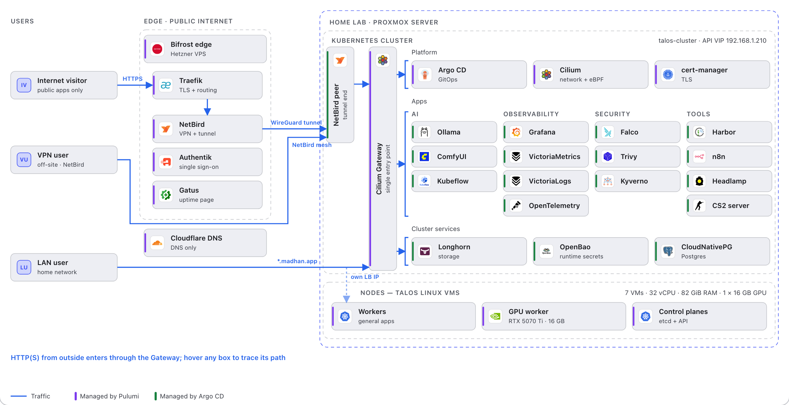

# HomeLab

Kubernetes on Talos Linux, provisioned by Pulumi on Proxmox and run by Argo CD. Bare VMs to running apps, all in code.

**Docs: [homelab.madhan.app](https://homelab.madhan.app)**

<a href="https://homelab.madhan.app">
  <picture>
    <source media="(prefers-color-scheme: dark)" srcset="assets/img/architecture-dark.png">
    
  </picture>
</a>

The diagram is interactive on the [docs site](https://homelab.madhan.app): every box links to its page.

- [Get started](https://homelab.madhan.app/start/): prerequisites and first deploy
- [How it works](https://homelab.madhan.app/concepts/): the four layers and the tools behind each one
- [Architecture diagrams](https://homelab.madhan.app/diagrams/): the same cluster drawn five ways
- [Releases](https://homelab.madhan.app/releases/v0-1-8/): what changed and the upgrade steps
