# Cilium and NetBird in the homelab — from first principles

This guide explains how traffic moves through the homelab, starting from basic
networking and ending at the exact configuration in this repo. It assumes no
prior knowledge of Kubernetes networking. Each section builds on the previous
one, so read it in order the first time.

Diagrams use Mermaid and render on GitHub and in VS Code's Markdown preview.

**Contents**

1. [Networking basics you need first](#1-networking-basics-you-need-first)
2. [Kubernetes networking: the problem a CNI solves](#2-kubernetes-networking-the-problem-a-cni-solves)
3. [What Cilium is and how eBPF works](#3-what-cilium-is-and-how-ebpf-works)
4. [Cilium's building blocks in general](#4-ciliums-building-blocks-in-general)
5. [The homelab's physical and virtual layout](#5-the-homelabs-physical-and-virtual-layout)
6. [Cilium in this homelab, setting by setting](#6-cilium-in-this-homelab-setting-by-setting)
7. [Following a request from your laptop to a pod](#7-following-a-request-from-your-laptop-to-a-pod)
8. [WireGuard and NetBird in general](#8-wireguard-and-netbird-in-general)
9. [NetBird in this homelab](#9-netbird-in-this-homelab)
10. [Following a request from the internet to a pod](#10-following-a-request-from-the-internet-to-a-pod)
11. [Why the routing peer must not use hostNetwork](#11-why-the-routing-peer-must-not-use-hostnetwork)
12. [Failure modes and how to diagnose them](#12-failure-modes-and-how-to-diagnose-them)
13. [Command cheat sheet](#13-command-cheat-sheet)
14. [Glossary](#14-glossary)

---

## 1. Networking basics you need first

### 1.1 IP addresses and subnets

Every device on a network has an **IP address**, such as `192.168.1.221`. A
**subnet** is a range of addresses that sit on the same local network, written
in CIDR notation: `192.168.1.0/24` means "the first 24 bits are fixed", so it
covers `192.168.1.0` to `192.168.1.255` (256 addresses).

The `/N` number tells you how big the range is:

| CIDR | Addresses | Used here for |
|---|---|---|
| `/32` | 1 | A single LoadBalancer IP in the Cilium pool |
| `/24` | 256 | The home LAN `192.168.1.0/24`; one node's pod range, e.g. `10.244.6.0/24` |
| `/16` | 65,536 | All pods `10.244.0.0/16`; the NetBird overlay `100.109.0.0/16` |
| `/12` | ~1 million | All Kubernetes Services `10.96.0.0/12` |

**Private ranges** (`10.x`, `172.16–31.x`, `192.168.x`, and the carrier-grade
range `100.64–127.x` that NetBird uses) never route on the public internet. They
only mean something inside a network you control.

### 1.2 Layer 2 vs layer 3: MAC addresses and IP addresses

Networks are described in **layers**. Two matter here:

- **Layer 2 (L2, "link")**: delivery between devices on the *same* physical or
  virtual segment, using **MAC addresses** (hardware addresses such as
  `bc:24:11:e9:4a:e8`). A switch forwards frames by MAC address. An **Ethernet
  frame** is a packet wrapped with a source MAC and a destination MAC.
- **Layer 3 (L3, "network")**: delivery across networks, using **IP addresses**.
  A router forwards packets by IP address.

To send an IP packet to a neighbour, a machine must put that neighbour's MAC
address on the frame. It finds the MAC using ARP.

### 1.3 ARP: "who has this IP?"

**ARP (Address Resolution Protocol)** is a broadcast question on the local
segment: *"Who has 192.168.1.220? Tell 192.168.1.1."* Whoever owns that IP
replies: *"192.168.1.220 is at bc:24:11:…"*. The asker caches the answer in its
**ARP table** (also called the neighbour table) for a while.

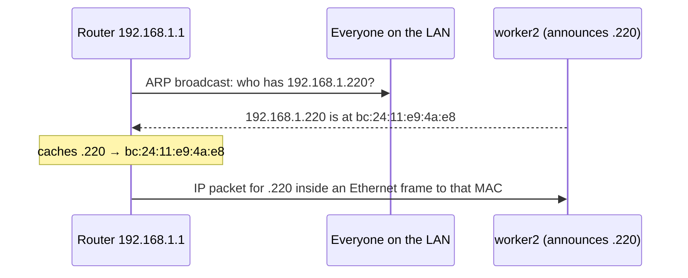

Key idea for later: **an IP address is only reachable on a LAN if some machine
answers ARP for it.** Cilium uses this to make "virtual" IPs reachable.

### 1.4 Routing tables and default gateways

Every machine has a **routing table**: a list of "to reach network X, send via
Y, out interface Z". For example:

```
192.168.1.0/24 dev ens18          # directly connected: ARP and send
default via 192.168.1.1 dev ens18  # everything else: hand it to the router
```

If the destination is in a directly connected subnet, the machine ARPs for it
and sends it straight there. Otherwise it sends the packet to the **default
gateway** (the router), which repeats the process.

### 1.5 NAT and masquerading

**NAT (Network Address Translation)** rewrites addresses in a packet as it
passes through a machine.

- **SNAT / masquerade** rewrites the *source* address. Your home router does
  this: your laptop's `192.168.x.x` becomes your public IP on the way out, and
  the router remembers the mapping so replies come back to you.
- **DNAT** rewrites the *destination* address. A load balancer does this: a
  packet to a virtual IP gets its destination rewritten to a real backend.

The kernel remembers each translation in **conntrack** (the connection
tracking table), so reply packets are translated back automatically.

### 1.6 Network namespaces and interfaces

Linux can create isolated network stacks called **network namespaces
(netns)**. Each one has its own interfaces, routing table, ARP table and
firewall rules. A container or Kubernetes pod normally gets its own netns.

A **veth pair** is a virtual cable with two ends. One end sits in the pod's
netns as `eth0`; the other sits in the host netns (Cilium names it `lxc…`).
Whatever goes in one end comes out the other.

"**hostNetwork**" means a pod skips its own netns and uses the node's network
stack directly. That will matter a lot in section 11.

### 1.7 Tunnels and encapsulation

A **tunnel** wraps a packet inside another packet so it can cross a network
that would not deliver it directly. Two tunnels appear in this homelab:

- **VXLAN** (Cilium): wraps pod-to-pod packets in UDP so they cross the LAN
  between nodes.
- **WireGuard** (NetBird): wraps packets in *encrypted* UDP so they cross the
  internet between the VPS and the cluster.

```
Original packet:          [ IP src=10.244.2.5 dst=10.244.5.9 | TCP | data ]
After VXLAN encapsulation:
[ IP src=192.168.1.222 dst=192.168.1.223 | UDP 8472 | VXLAN | original packet ]
```

### 1.8 TCP ports, TLS and HTTP Host routing

A **port** identifies a service on a machine: 80 for HTTP, 443 for HTTPS. **TLS**
encrypts the connection; the server proves its identity with a **certificate**.
With **SNI** and the HTTP **Host header**, one IP address can serve many
websites: the proxy reads `Host: grafana.madhan.app` and picks the right
backend. Both the Cilium Gateway and Traefik work this way.

---

## 2. Kubernetes networking: the problem a CNI solves

### 2.1 The rules Kubernetes imposes

Kubernetes requires that:

1. Every **pod** gets its own IP address.
2. Every pod can reach every other pod by IP, on any node, **without NAT**.
3. Nodes can reach all pods.

Kubernetes does not implement any of this itself. It delegates to a **CNI
(Container Network Interface) plugin**. When a pod starts, the kubelet asks the
CNI to create its network interface and give it an IP. Cilium is the CNI here.

### 2.2 Pod IPs are per-node ranges

The cluster's pod range `10.244.0.0/16` is cut into one `/24` per node:

| Node | Node IP | Pod range (podCIDR) |
|---|---|---|
| k8s-controller1 | 192.168.1.211 | 10.244.3.0/24 |
| k8s-controller2 | 192.168.1.212 | 10.244.0.0/24 |
| k8s-controller3 | 192.168.1.213 | 10.244.1.0/24 |
| k8s-worker1 | 192.168.1.221 | 10.244.8.0/24 |
| k8s-worker2 | 192.168.1.222 | 10.244.2.0/24 |
| k8s-worker3 | 192.168.1.223 | 10.244.5.0/24 |
| k8s-worker4 | 192.168.1.224 | 10.244.6.0/24 |

So a pod with IP `10.244.6.140` lives on worker4. Cilium is set to
`ipam.mode: kubernetes`, which means it uses exactly these ranges that
Kubernetes assigned to each node.

### 2.3 Services: stable virtual IPs in front of pods

Pods come and go, and their IPs change. A **Service** gives a group of pods one
stable **ClusterIP** (from `10.96.0.0/12`) and a DNS name such as
`openbao.openbao.svc.cluster.local`. Traffic to the ClusterIP is load-balanced
(DNAT) to one of the pods behind it.

A ClusterIP does not belong to any interface. Nobody answers ARP for it, and it
is only reachable from inside the cluster, because something on every node
intercepts traffic to it and rewrites the destination. Traditionally that
"something" is **kube-proxy** with thousands of iptables rules. Here Cilium
replaces kube-proxy entirely.

Service types:

| Type | Reachable from | How |
|---|---|---|
| `ClusterIP` | Inside the cluster | Virtual IP, rewritten on every node |
| `NodePort` | Anything that can reach a node | A port (30000–32767) open on every node IP |
| `LoadBalancer` | The LAN (or internet) | A real-looking IP on the LAN; something must make it reachable |

On a cloud provider, a `LoadBalancer` Service gets a cloud load balancer. On
bare metal (like Proxmox at home) nothing provides one by default. Cilium's
**LB-IPAM** and **L2 announcements** fill that gap (section 4.5).

### 2.4 Ingress and the Gateway API

To expose many websites on one IP, Kubernetes uses an HTTP proxy configured by
resources:

- **Ingress** is the older API.
- **Gateway API** is the newer one. A **Gateway** is "a proxy listening on these
  ports with these certificates". An **HTTPRoute** is "send `Host: X` and path
  `/Y` to Service Z". Routes in any namespace attach to the shared Gateway.

This homelab uses the Gateway API, implemented by Cilium (with Envoy as the
proxy).

---

## 3. What Cilium is and how eBPF works

### 3.1 eBPF in one paragraph

**eBPF** lets you load small, verified programs into the Linux kernel and attach
them to "hooks": a network interface receiving a packet, a socket being
created, a system call. The kernel's **verifier** checks each program is safe
(it cannot crash the kernel or loop forever) before running it. eBPF programs
share data through **BPF maps**: key-value tables living in the kernel, such as
"Service IP → list of backends".

Because eBPF runs inside the kernel at the point where a packet arrives, it can
drop, rewrite or redirect the packet before the normal (slower) network stack
even sees it.

### 3.2 Where Cilium hooks in

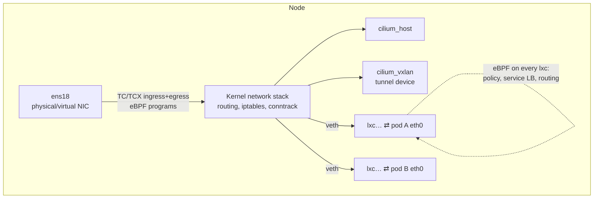

- **TC / TCX programs on the NIC** (`ens18`, `eth0`): handle traffic entering
  and leaving the node. This is where LoadBalancer IPs are recognised, and
  where Cilium answers ARP for them.
- **Programs on each pod's `lxc` interface**: apply network policy, do Service
  load balancing for traffic leaving the pod, and route to other pods.
- **`cilium_vxlan`**: the VXLAN tunnel device for traffic to pods on other nodes.
- **`cilium_host`**: the node's own gateway into the pod network.

"Attach Mode: TCX" in `cilium status` means Cilium uses the newer TCX attach
API of the kernel's traffic-control layer.

### 3.3 Cilium's components

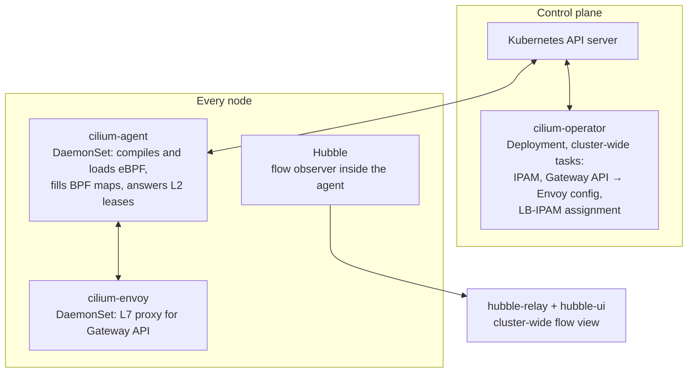

| Component | Kind | Job |
|---|---|---|
| `cilium-agent` | DaemonSet (one per node) | Watches Kubernetes, programs eBPF and BPF maps on its node, takes part in L2 announcement elections |
| `cilium-operator` | Deployment | Cluster-wide work: turns Gateway/HTTPRoute objects into Envoy config, assigns LoadBalancer IPs from the pool |
| `cilium-envoy` | DaemonSet | The actual HTTP/TLS proxy behind the Gateway (`Envoy: external` in status) |
| Hubble | Part of the agent, plus relay and UI | Records every flow so you can see what was allowed or dropped |

---

## 4. Cilium's building blocks in general

### 4.1 CNI and IPAM

When a pod is created, the agent:

1. Picks a free IP from the node's podCIDR (IPAM).
2. Creates a veth pair: `eth0` in the pod, `lxc<hash>` on the host.
3. Gives the pod a default route through that veth.
4. Attaches eBPF programs to the `lxc` end and records the pod as a Cilium
   **endpoint**, with an **identity** derived from its labels.

### 4.2 Routing modes: tunnel vs native

Cilium must deliver pod-to-pod traffic between nodes. Two modes:

| Mode | How | When to use |
|---|---|---|
| **Tunnel (VXLAN or Geneve)** | Wrap pod packets in UDP between node IPs | Works on any network; the LAN does not need to know pod ranges |
| **Native routing** | Send pod packets unwrapped; the network routes `10.244.x.0/24` to each node | Faster, but the router or the nodes need routes for every pod range |

This cluster uses **VXLAN tunnel mode** (UDP port 8472). Your home router never
sees a `10.244.x.x` address.

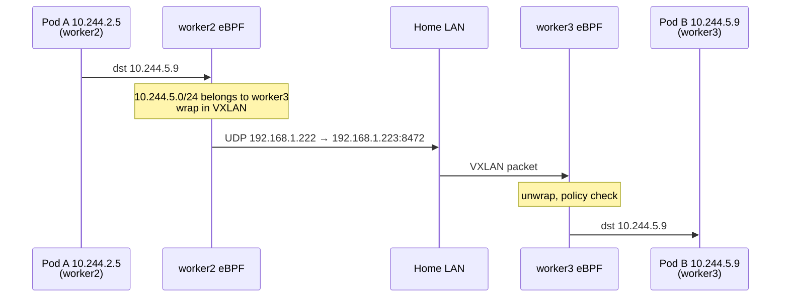

### 4.3 kube-proxy replacement (Service load balancing in eBPF)

With `kubeProxyReplacement: true`, there is no kube-proxy. Cilium stores every
Service in BPF maps (`cilium-dbg service list` shows them). When a packet to a
ClusterIP, NodePort or LoadBalancer IP passes a Cilium hook, the eBPF program
picks a backend and DNATs the packet, recording the translation so replies are
reversed.

There are two places this can happen:

- **Socket-level LB**: when a program calls `connect()` to a Service IP,
  Cilium rewrites the address before any packet exists. **Disabled in this
  cluster** (section 6).
- **Packet-level LB**: on the TC hooks of the NIC and each `lxc` interface.
  This is what this cluster uses.

### 4.4 Masquerading

When a pod talks to something outside the cluster (the internet, or a LAN host
such as Proxmox), its `10.244.x.x` source address means nothing out there. The
node **masquerades** the packet so it leaves with the node's IP. Here this is
done with iptables (`Masquerading: IPTables`).

### 4.5 LB-IPAM and L2 announcements: LoadBalancers on bare metal

These two features turn a `LoadBalancer` Service into a reachable LAN address.

1. **LB-IPAM** (`CiliumLoadBalancerIPPool`) hands out IPs from a pool you
   define. The Service's `EXTERNAL-IP` becomes, for example, `192.168.1.220`.
2. **L2 announcements** (`CiliumL2AnnouncementPolicy`) make one node answer ARP
   for that IP, so the LAN can find it.

No interface on any node actually has `192.168.1.220` configured. The node that
"owns" it just answers ARP with its own MAC, then its eBPF program recognises
packets for `.220` and load-balances them.

**Which node answers? A leader election using Kubernetes Leases.** For each
announced Service, every eligible node's agent tries to take a **Lease** object
named `cilium-l2announce-<namespace>-<service>`. The winner is the
**holder**. It renews the lease every few seconds. If it stops renewing (node
died, agent crashed), another node takes over within seconds and starts
answering ARP, usually with a **gratuitous ARP** to update neighbours' caches.

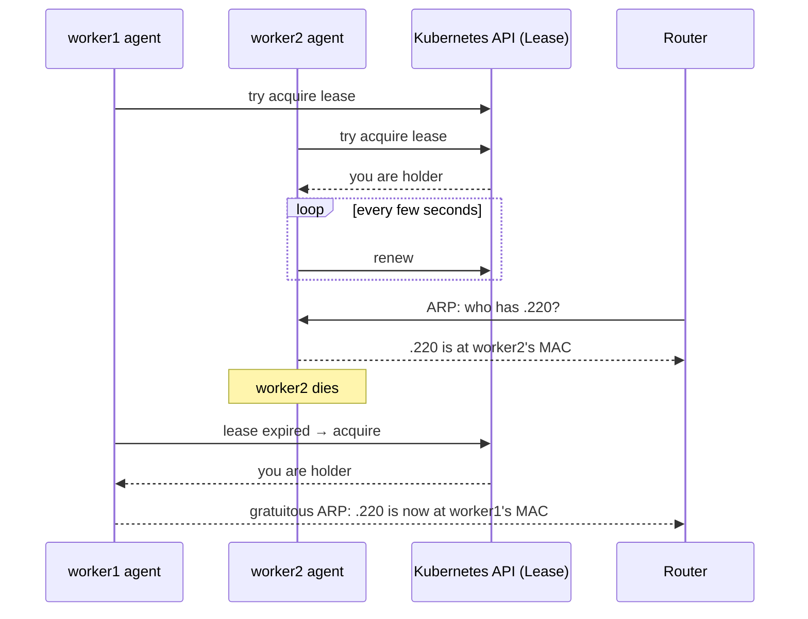

Two important limits of L2 mode:

- **All traffic for one IP enters through one node** (the holder). Cilium then
  spreads it to backends across the cluster. It is failover, not
  multi-node load balancing.
- **The holder itself cannot ARP-resolve the IP it announces.** Cilium answers
  ARP requests *arriving* on the NIC; a request the node's own kernel sends
  out never comes back in to be answered. This caused the November 2026 outage
  (section 11).

### 4.6 Gateway API with Envoy

When you create a `Gateway` with `gatewayClassName: cilium`:

1. The **operator** creates a `LoadBalancer` Service
   (`cilium-gateway-<name>`), which LB-IPAM gives an IP.
2. The operator translates every attached `HTTPRoute` into Envoy configuration
   (a `CiliumEnvoyConfig`).
3. On each node, packets to the Gateway IP on ports 80/443 are redirected by
   eBPF into the local **cilium-envoy** proxy (`cilium-dbg service list` shows
   the backend as `127.0.0.1:<proxy port>`, marked `l7-load-balancer`).
4. Envoy terminates TLS, reads the Host header, and forwards to the right
   Service's pods.

### 4.7 Network policy and identities

Cilium gives each set of pods with the same labels a numeric **security
identity**. Policies (`NetworkPolicy`, `CiliumNetworkPolicy`) are compiled
into BPF maps keyed by identity, so the decision does not depend on pod IPs.
Some Helm charts here ship their own NetworkPolicies (Longhorn, for example),
and Cilium enforces them.

### 4.8 Hubble

Hubble records each flow (source, destination, verdict, drop reason). The UI at
`hubble.madhan.app` shows a live service map. `cilium-dbg monitor --type drop`
on an agent shows drops on that node.

---

## 5. The homelab's physical and virtual layout

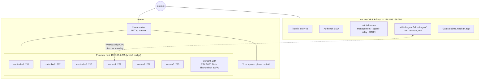

| Item | Value | Where it is set |
|---|---|---|
| LAN subnet | `192.168.1.0/24` | `config/config.yml` `cluster.subnet` |
| Kubernetes API VIP | `192.168.1.210:6443` | `cluster.vip` (Talos-managed, shared by the control planes) |
| LoadBalancer pool | `192.168.1.220–230`, minus node IPs | `cluster.lb_pool` |
| Gateway IP | `192.168.1.220` | First pool address, taken by the Gateway Service |
| Other LB IPs | `.225` ollama, `.230` cs2 | Their own `LoadBalancer` Services |
| Pod CIDR | `10.244.0.0/16`, `/24` per node | Kubernetes |
| Service CIDR | `10.96.0.0/12` | Kubernetes |
| NetBird overlay | `100.109.0.0/16` | NetBird management |
| DNS | `*.madhan.app → 192.168.1.220`; public names → `178.156.199.250` | `core/cloud/cloudflare.go` |

All VMs run **Talos Linux**: a minimal, API-managed OS for Kubernetes.
Each VM has one VirtIO NIC on the Proxmox bridge `vmbr0`, so from the network's
point of view every node is a separate machine plugged into the home LAN.

---

## 6. Cilium in this homelab, setting by setting

Cilium **1.20.4** is installed by Pulumi from `core/platform/cilium.go`, not by
Argo CD, because nothing (including Argo CD) can run before the CNI exists.

### 6.1 Helm values explained

| Value | Setting | What it means | Why it is set this way |
|---|---|---|---|
| `ipam.mode` | `kubernetes` | Use each node's podCIDR from Kubernetes | Simple, predictable `/24` per node |
| `kubeProxyReplacement` | `true` | No kube-proxy; eBPF does all Service LB | Talos is installed without kube-proxy |
| `k8sServiceHost/Port` | `192.168.1.210:6443` | How the agent reaches the API server | Without kube-proxy the agent cannot use the `kubernetes` ClusterIP until it has programmed it itself, so it needs a real address: the VIP |
| `devices` | `ens18`, `eth0` | NICs Cilium attaches to and announces on | Talos named the NIC differently across upgrades. **Never add `wt0`** (section 6.4) |
| `l2announcements.enabled` | `true` | Turn on ARP answering for LB IPs | Bare metal has no cloud load balancer |
| `gatewayAPI.enabled` | `true` | Cilium implements the Gateway API | One shared HTTPS entry point |
| `gatewayAPI.secretsNamespace.sync` | `true` | Cilium copies the Gateway's TLS secret into `cilium-secrets` for Envoy | Cilium must own that copy; a foreign owner caused a cert-reissue loop that hit Let's Encrypt rate limits |
| `bpf.hostLegacyRouting` | `true` | Host-namespace traffic uses the normal kernel routing table | eBPF host routing broke Talos's host DNS forwarding, kubelet (10250) and Talos apid (50000) |
| `socketLB.enabled` | `false` | No `connect()`-time Service rewriting | Its bind hooks interfered with kubelet and apid binding their ports |
| `installNoConntrackIptablesRules` | `false` | Keep conntrack for host traffic | NOTRACK plus drop-invalid rules blocked new TCP to host ports |
| `hubble.relay/ui` | enabled | Flow visibility | `hubble.madhan.app` |
| Routing | VXLAN tunnel (default) | Pod traffic between nodes is encapsulated | The home router needs no pod routes |

### 6.2 The LoadBalancer pool

`ConfigureCiliumIPPool` builds a `CiliumLoadBalancerIPPool` named
`address-pool` from `lb_pool` (`.220–.230`), **one `/32` block per address,
skipping any address that is also a node IP** (`.221–.224` are workers).
Announcing a node's own IP over L2 would make two machines answer ARP for the
same address and knock that node off the LAN, so those are left out.

### 6.3 The L2 announcement policy

```yaml
apiVersion: cilium.io/v2alpha1
kind: CiliumL2AnnouncementPolicy
metadata: {name: l2-policy}
spec:
  nodeSelector:            # only workers may announce
    matchExpressions:
      - {key: node-role.kubernetes.io/control-plane, operator: DoesNotExist}
  interfaces: ["^(eth0|ens.*|enp.*)"]   # announce on the LAN NIC only
  loadBalancerIPs: true    # announce LoadBalancer IPs
  externalIPs: false       # never announce spec.externalIPs
```

So the Gateway IP `.220` is always answered by **one of the four workers**.
`kubectl -n kube-system get lease cilium-l2announce-kube-system-cilium-gateway-homelab-gateway`
shows which one.

A `ValidatingAdmissionPolicy` (`deny-service-external-ips`) also rejects any
Service using `spec.externalIPs`. That field would let any Service author
capture traffic to an arbitrary IP (CVE-2020-8554), and kube-proxy replacement
cannot turn it off.

### 6.4 Why `wt0` must never be a Cilium device

`wt0` is NetBird's WireGuard interface. It is **NOARP / POINTOPOINT**: it
carries bare IP packets with no Ethernet header. Cilium's TC programs on a
device expect Ethernet frames, so on `wt0` they misread every packet and drop
it, **without any monitor event**. The tunnel would look healthy and carry
nothing. NetBird traffic reaches Cilium another way (section 9.4).

### 6.5 The Gateway

Created by `InstallGateway` in the same file:

```yaml
apiVersion: gateway.networking.k8s.io/v1
kind: Gateway
metadata: {name: homelab-gateway, namespace: kube-system}
spec:
  gatewayClassName: cilium
  listeners:
    - {name: http,  protocol: HTTP,  port: 80,  allowedRoutes: {namespaces: {from: All}}}
    - name: https
      protocol: HTTPS
      port: 443
      allowedRoutes: {namespaces: {from: All}}
      tls:
        mode: Terminate
        certificateRefs: [{name: wildcard-madhan-app-tls, namespace: kube-system}]
```

- cert-manager issues the wildcard certificate `*.madhan.app` with a DNS-01
  challenge through Cloudflare.
- Each app ships an `HTTPRoute` (from CDK8s in `workloads/`) that attaches to
  `homelab-gateway` with its hostname, for example `chat.madhan.app →
  open-webui:8080`.
- The Gateway API CRDs are vendored (`platform/manifests/gateway-api-v1.6.3-experimental-install.yaml`)
  and installed **before** Cilium, because the operator only enables its
  Gateway controller for CRDs that exist when it starts.

### 6.6 What it looks like live

```text
$ kubectl -n kube-system exec ds/cilium -c cilium-agent -- cilium-dbg status
KubeProxyReplacement:    True   [ens18 192.168.1.212 ... (Direct Routing)]
Cilium:                  Ok   1.20.4
IPAM:                    IPv4: 10/254 allocated from 10.244.0.0/24
Routing:                 Network: Tunnel [vxlan]   Host: Legacy
Attach Mode:             TCX
Masquerading:            IPTables [IPv4: Enabled, IPv6: Disabled]
Proxy Status:            OK, ... Envoy: external
Cluster health:          7/7 reachable

$ kubectl -n kube-system get svc cilium-gateway-homelab-gateway
TYPE          CLUSTER-IP      EXTERNAL-IP     PORT(S)
LoadBalancer  10.107.32.107   192.168.1.220   80:32601/TCP,443:30425/TCP
```

---

## 7. Following a request from your laptop to a pod

You open `https://grafana.madhan.app` on the home network.

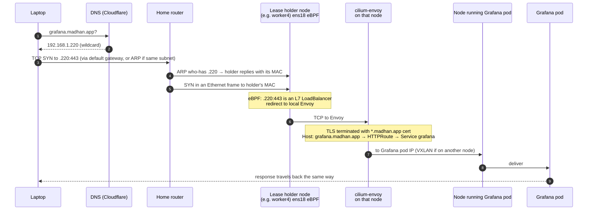

Step by step:

1. **DNS.** `*.madhan.app` resolves to `192.168.1.220`. That record is public,
   but `192.168.1.220` is a private address, so the name only works on the home
   LAN.
2. **Getting to `.220`.** If your laptop is on `192.168.1.0/24`, it ARPs for
   `.220` itself. If it is on another home subnet, it sends to its router, and
   the router ARPs. Either way **the L2 lease holder answers**.
3. **Into the node.** The frame arrives on the holder's `ens18`. Cilium's TC
   program sees destination `.220:443`, finds the Gateway Service in its BPF
   map, and redirects the connection to the local **cilium-envoy**.
4. **Envoy.** Terminates TLS, matches `Host: grafana.madhan.app` against the
   HTTPRoutes, and picks a Grafana pod.
5. **To the pod.** If the pod is on the same node, the packet goes straight
   into its `lxc` veth. If not, Cilium wraps it in VXLAN to the right node.
6. **Reply.** Everything is reversed using conntrack and Envoy's connection.

---

## 8. WireGuard and NetBird in general

### 8.1 The problem

The homelab is behind your home router's NAT. Nothing on the internet can open
a connection to it, and you do not want to forward ports. Yet you want a few
services (`grafana`, the NetBird dashboard, Authentik) reachable from anywhere,
plus private VPN access to the whole LAN.

The answer is a **VPS with a public IP** that the homelab connects *out* to,
over an encrypted tunnel. Outbound connections pass through NAT without any
port forwarding.

### 8.2 WireGuard

**WireGuard** is a VPN protocol built into the Linux kernel. Each **peer** has a
key pair. You configure "peer X has public key K, lives at endpoint IP:port,
and may send traffic for these IPs (`AllowedIPs`)". WireGuard then creates an
interface (here `wt0`). Anything routed into `wt0` is encrypted and sent over
UDP to the right peer, and decrypted packets pop out of `wt0` on the other side.

WireGuard alone has no idea how to find peers behind NAT, distribute keys, or
manage who may talk to whom. NetBird adds all of that.

### 8.3 NetBird's pieces

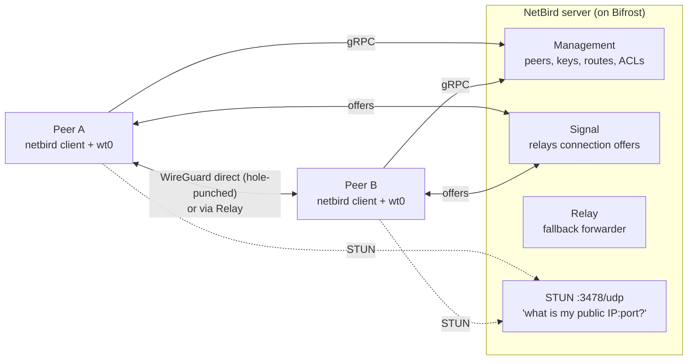

| Piece | Job |
|---|---|
| **Management** | Central database of peers, their WireGuard public keys, overlay IPs (`100.109.x.x`), groups, ACLs and **network routes**. Each client keeps a gRPC stream open and receives updates. |
| **Signal** | Passes connection offers between two peers so they can attempt a direct link. Never sees traffic. |
| **STUN** | Tells a peer its public IP and port as seen from the internet, used for **NAT hole punching**. |
| **Relay** | When no direct path works (strict NAT), traffic goes through the relay, still WireGuard-encrypted end to end. |
| **Client** (`netbird`) | Runs on each peer, creates `wt0`, programs routes and firewall rules, and keeps WireGuard config in sync with management. |
| **Dashboard** | Web UI at `netbird.madhan.app`. |
| **Setup key** | One-time token a headless peer uses to register itself. After that, the peer authenticates with its stored private key. |

### 8.4 Routing peers and network routes

A normal peer only makes *itself* reachable. A **routing peer** advertises a
whole network behind it. You create a **network route** in the dashboard:
"network `192.168.1.0/24` is reachable through peer `k8s-routing-peer`, for
peers in group `All`". Every other peer in that group then routes
`192.168.1.0/24` into its `wt0`, and the routing peer forwards those packets
onto the LAN.

With the route's **Masquerade** option on, the routing peer SNATs forwarded
packets to its own address, so LAN devices reply to it and need no route back
to the `100.109.0.0/16` overlay.

---

## 9. NetBird in this homelab

### 9.1 Who runs what

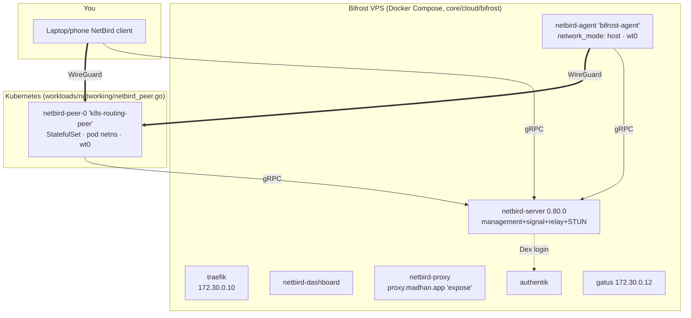

| Peer | Where | Network mode | Role |
|---|---|---|---|
| `bifrost-agent` | `netbird-agent` container on the VPS | `network_mode: host`, so `wt0` is on the VPS itself | Lets Traefik and Gatus on the VPS reach `192.168.1.0/24` |
| `k8s-routing-peer` | `netbird-peer-0` pod on any worker | **Own pod network namespace** | Routing peer for `192.168.1.0/24` |
| Your devices | Laptop or phone | Normal client | VPN into the LAN from anywhere |

The NetBird route lives in the dashboard, not in code:
**Network → Routes → `192.168.1.0/24`, routing peer `k8s-routing-peer`,
distribution group `All`, Masquerade on.** `bifrost-agent` must be in group
`All`, or the VPS never learns the route.

On the VPS, the NetBird client installs the route in its own routing table
(table `7120`): `192.168.1.0/24 dev wt0`. So when Traefik connects to
`http://192.168.1.220`, the VPS kernel sends it into `wt0`.

### 9.2 The k8s routing peer, line by line

From `workloads/networking/netbird_peer.go`:

| Setting | Value | Why |
|---|---|---|
| Kind | StatefulSet, 1 replica, headless Service | Stable name and its own PVC |
| PVC | `netbird-config`, 100Mi, at `/var/lib/netbird` | Holds the peer's private key. Without it, every restart registers a new duplicate peer |
| `hostNetwork` | **not set (false)** | `wt0` lives in the pod's netns; see section 11 |
| Privileged, `NET_ADMIN`, `SYS_MODULE` | | Create the WireGuard interface, edit routes and iptables inside the pod |
| `NB_SETUP_KEY` | From OpenBao via the CSI driver (`netbird-setup-key` Secret) | Only used on first registration |
| `NB_MANAGEMENT_URL` | `https://netbird.madhan.app` | The management server on Bifrost |
| `NB_HOSTNAME` | `k8s-routing-peer` | Name the route is assigned to |
| Init container `setup-iptables` | `iptables -t nat -A POSTROUTING ! -o wt0 -d 192.168.1.0/24 -j MASQUERADE` | Fallback NAT. NetBird's own `NETBIRD-RT-NAT` chain (from the route's Masquerade toggle) normally matches first |
| No `nodeSelector` | | The pod can float to any worker |
| `NB_SKIP_SOCKET_MARK` | **never set** | See below |

**Why socket marks matter.** The client adds a route sending the management
server's IP (`178.156.199.250`) via `lo`, so ordinary traffic to the VPS cannot
accidentally loop into the tunnel. The client's own sockets carry a **firewall
mark (fwmark)** that a policy rule uses to bypass that route. Disable the mark
and the client's management and relay connections loop into the tunnel, the
relay never connects, and `wt0` carries 0 bytes.

### 9.3 What is inside the peer pod

```text
$ kubectl -n netbird exec netbird-peer-0 -c netbird -- netbird status
Management: Connected
Relays: 2/2 Available
Networks: 192.168.1.0/24
Peers count: 1/1 Connected

$ ... ip -br addr show wt0
wt0   UNKNOWN   100.109.244.71/16

$ ... iptables -t nat -S
-A POSTROUTING -j NETBIRD-RT-NAT
-A POSTROUTING -d 192.168.1.0/24 ! -o wt0 -j MASQUERADE        # init-container fallback
-A NETBIRD-RT-NAT ! -o lo -m mark --mark 0x1bd21 -j MASQUERADE  # NetBird route masquerade
```

### 9.4 How tunnel traffic reaches Cilium

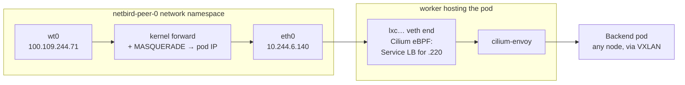

1. Decrypted packets come out of `wt0` **inside the pod**, with a source in
   `100.109.0.0/16` and a destination such as `192.168.1.220:80`.
2. The pod's kernel forwards them toward `eth0` (its default route) and
   masquerades the source to the pod IP `10.244.6.140`.
3. The packet leaves through the veth into the host's `lxc` interface, where
   **Cilium's eBPF program** sees "destination `.220:80` = Gateway
   LoadBalancer" and redirects it to the local Envoy. This is exactly what
   happens for any pod calling the Gateway, so it works on every node,
   including the L2 lease holder.
4. For other LAN destinations (say Proxmox at `192.168.1.235`), Cilium routes
   the packet out the node's NIC and the node masquerades it to the node IP.
5. Replies come back to the pod IP. Conntrack in the pod reverses the NAT and
   the reply goes back into `wt0`.

`wt0` itself never touches a Cilium-managed device, so the "no `wt0` in
devices" rule (section 6.4) is satisfied.

---

## 10. Following a request from the internet to a pod

Someone opens `https://grafana.madhan.app` from outside your home.

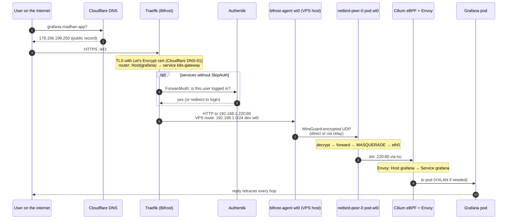

Details worth knowing:

- **Which names are public.** Cloudflare has a wildcard `*` → `192.168.1.220`
  (LAN only). Explicit records point `auth`, `netbird`, `proxy`, `uptime`, and
  every entry in `publicServices` (`core/cloud/cloudflare.go`, today only
  `grafana`) at the VPS. Records are DNS-only (not proxied through Cloudflare).
- **Public routes** are generated into `traefik/dynamic/public-services.yml` by
  `hetzner.go`. Each sends to the `k8s-gateway` service,
  `http://192.168.1.220`, with Authentik ForwardAuth unless `SkipAuth` (Grafana
  has its own Authentik OIDC login).
- **TLS happens twice in principle, but only once here.** Traefik terminates
  TLS on the VPS, then speaks plain HTTP to `.220:80` inside the encrypted
  WireGuard tunnel.
- **Gatus** on the VPS checks every in-cluster service through this same
  tunnel path. When Gatus shows *everything* red while pods are healthy, the
  problem is the path (tunnel, routing peer, `.220`), not the apps.

---

## 11. Why the routing peer must not use hostNetwork

Until November 2026 the peer ran with `hostNetwork: true`. Here is what that
did, and why it broke after the power outage.

With hostNetwork, `wt0` was on the **node** itself. Forwarded packets to
`.220` went through the node's normal routing table: `192.168.1.0/24 dev ens18`,
so the node **ARPed for `.220` on the LAN** and expected another node (the
lease holder) to answer. Packets forwarded from `wt0` never pass any Cilium
hook on the way in (`wt0` is not a Cilium device), so the only way for them to
reach Cilium was to leave the NIC and come back in on the holder.

That works only while the peer and the lease holder are on **different
nodes**. When both land on the same node:

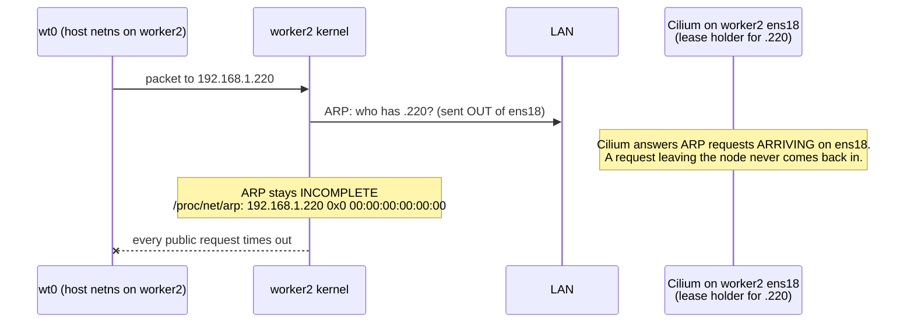

After the outage, both ended up on worker2. Every public service went dark,
while the same services worked fine from inside the cluster. The emergency fix
was to delete the lease so another node took it. The permanent fix (commit
`39bd7729`) removed `hostNetwork`: now packets leave through the pod's `eth0`
and Cilium handles `.220` on the pod's own node, wherever the lease is. It was
verified with the peer and the lease holder **both on worker4**, with every
Gatus check green.

---

## 12. Failure modes and how to diagnose them

### 12.1 Decision tree

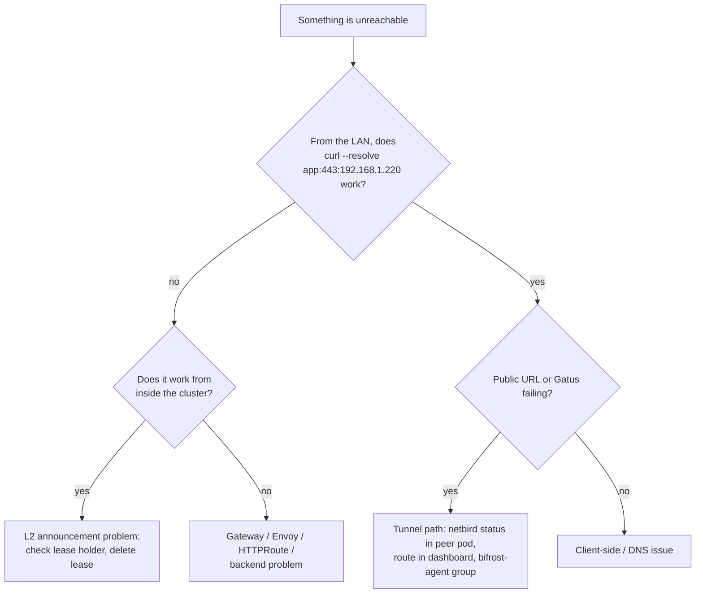

### 12.2 Known failure modes

| Symptom | Cause | Fix |
|---|---|---|
| LAN times out on `.220`, in-cluster works, lease renewing | Stale L2 lease holder stopped answering ARP after an agent restart | `kubectl -n kube-system delete lease cilium-l2announce-kube-system-cilium-gateway-homelab-gateway` (or `just gateway-repair-l2`) |
| `.220` dark for ~35s during a Cilium upgrade | The holder's agent is restarting | Self-recovers |
| Gatus all red, pods fine, LAN fine | Tunnel broken: peer down, route unassigned, `bifrost-agent` not in `All`, or socket mark disabled | `netbird status` in the peer pod; check the route in the dashboard |
| `wt0` exists, 0 bytes | `NB_SKIP_SOCKET_MARK` set, or management route loop | Remove it; restart the peer |
| Tunnel up, nothing passes, no drop events | `wt0` added to Cilium `devices` | Remove it from `cilium.go` |
| A node cut off from the LAN after a Cilium upgrade | A pool IP equal to a node IP | The pool generator skips node IPs; check `lb_pool` |
| New HTTPRoute has no status and returns 404 | Stale operator watch after API server restarts | Delete the cilium-operator leader pod |
| Every new peer registration duplicates | PVC not mounted at `/var/lib/netbird` | Fix the mount path |

---

## 13. Command cheat sheet

```bash
# --- Cilium health ---
kubectl -n kube-system exec ds/cilium -c cilium-agent -- cilium-dbg status
kubectl -n kube-system get pods -l k8s-app=cilium -o wide
kubectl -n kube-system get pods -l k8s-app=cilium-envoy -o wide

# --- Services as Cilium sees them (BPF maps) ---
kubectl -n kube-system exec ds/cilium -c cilium-agent -- cilium-dbg service list
kubectl -n kube-system exec ds/cilium -c cilium-agent -- cilium-dbg bpf lb list | grep 192.168.1.220

# --- L2 announcements ---
kubectl -n kube-system get leases | grep l2announce                 # holder per LB IP
kubectl get ciliuml2announcementpolicy -o yaml
kubectl get ciliumloadbalancerippool -o yaml
# on the holder's agent:
kubectl -n kube-system exec <cilium-pod> -c cilium-agent -- cilium-dbg shell -- db/show l2-announce
# a node's ARP table (agent pods are hostNetwork):
kubectl -n kube-system exec <cilium-pod> -c cilium-agent -- cat /proc/net/arp

# --- Gateway ---
kubectl get gateway -A
kubectl get httproute -A
curl -sk --resolve grafana.madhan.app:443:192.168.1.220 https://grafana.madhan.app -o /dev/null -w '%{http_code}\n'

# --- Drops ---
kubectl -n kube-system exec <cilium-pod> -c cilium-agent -- cilium-dbg monitor --type drop

# --- NetBird routing peer ---
kubectl -n netbird get pod netbird-peer-0 -o wide
kubectl -n netbird exec netbird-peer-0 -c netbird -- netbird status -d
kubectl -n netbird exec netbird-peer-0 -c netbird -- ip -br addr show wt0
kubectl -n netbird exec netbird-peer-0 -c netbird -- iptables -t nat -S

# --- From the VPS side ---
ssh root@178.156.199.250 'ip route show table 7120'      # expect 192.168.1.0/24 dev wt0
ssh root@178.156.199.250 'docker exec netbird-agent netbird status'

# --- Public path health ---
curl -s https://uptime.madhan.app/api/v1/endpoints/statuses | jq -r '.[] | "\(.name) \(.results[-1].success)"'
```

---

## 14. Glossary

| Term | Meaning |
|---|---|
| **ARP** | LAN protocol that maps an IP address to a MAC address |
| **CIDR** | `address/prefix` notation for an IP range |
| **CNI** | Plugin that gives pods their network; Cilium here |
| **ClusterIP** | Virtual Service IP reachable only inside the cluster |
| **conntrack** | Kernel table of connections, used to reverse NAT on replies |
| **DNAT / SNAT** | Rewriting a packet's destination / source address |
| **eBPF** | Verified programs running inside the Linux kernel |
| **BPF map** | Kernel key-value table shared by eBPF programs |
| **Envoy** | The L7 (HTTP/TLS) proxy Cilium uses for the Gateway API |
| **Gateway / HTTPRoute** | Gateway API objects: the listener, and the per-host routing rules |
| **Gratuitous ARP** | Unsolicited ARP reply announcing "this IP is now at my MAC" |
| **hostNetwork** | A pod using the node's network stack instead of its own |
| **kube-proxy replacement** | Cilium doing all Service load balancing in eBPF |
| **L2 / L3 / L7** | Link (MAC), network (IP), application (HTTP) layers |
| **L2 announcement** | Cilium answering ARP for a LoadBalancer IP from one elected node |
| **Lease** | Kubernetes object used for leader election; the holder announces the IP |
| **LB-IPAM** | Cilium assigning LoadBalancer IPs from a pool |
| **lxc interface** | Host-side end of a pod's veth pair |
| **Masquerade** | SNAT to the outgoing interface's address |
| **NAT hole punching** | Two NATed peers opening a direct UDP path with STUN's help |
| **Network namespace** | Isolated network stack (interfaces, routes, firewall) |
| **NOARP / POINTOPOINT** | Interface flags: no ARP and no Ethernet header; true for `wt0` |
| **Relay** | NetBird fallback that forwards encrypted traffic when no direct path works |
| **Routing peer** | NetBird peer that advertises a whole network (`192.168.1.0/24`) |
| **Setup key** | One-time token for headless NetBird registration |
| **Signal** | NetBird service that exchanges connection offers between peers |
| **STUN** | Tells a peer its public IP and port |
| **TC / TCX** | Linux traffic-control hook points where Cilium attaches eBPF |
| **veth pair** | Virtual cable between a pod's netns and the host |
| **VXLAN** | UDP encapsulation Cilium uses for pod traffic between nodes |
| **WireGuard** | Kernel VPN protocol NetBird uses |
| **wt0** | NetBird's WireGuard interface |

---

**Source files referenced:** `core/platform/cilium.go`, `config/config.yml`,
`workloads/networking/netbird_peer.go`, `core/cloud/cloudflare.go`,
`core/cloud/hetzner.go`, `core/cloud/bifrost/docker-compose.yml`,
`core/cloud/bifrost/traefik/dynamic/services.yml`. Site docs with more detail:
`docs/src/content/docs/platform/cilium.md`, `concepts/traffic.mdx`,
`cloud/netbird.mdx`, `workloads/networking/netbird-peer.md`.
