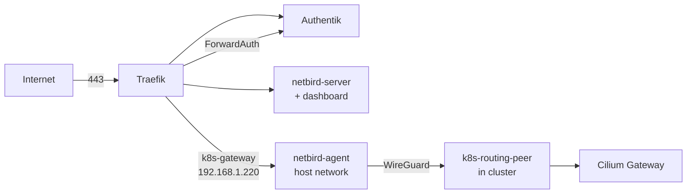

Bifrost is a Hetzner Cloud VPS that terminates public TLS and forwards traffic through the NetBird tunnel to the cluster Gateway, so no home IP is exposed. One command provisions and bootstraps it: `just core hetzner up`.

| | |
|---|---|
| Server | `bifrost-public-vps1` · `cpx21` · `ash` · Ubuntu (see `hetzner:` in [`config.yml`](src:config/config.yml)) |
| Public IP | `178.156.199.250` |
| Source | [`hetzner.go`](src:core/cloud/hetzner.go), [`bifrost/`](src:core/cloud/bifrost/docker-compose.yml) |
| On the VPS | `/etc/bifrost/`, run with `docker compose` |

## How it fits



The full packet path is in [Traffic](/concepts/traffic/).

| Container | Role |
|---|---|
| `traefik` | Only container with public ports (80, 443). File provider only, no Docker provider |
| `authentik-server`, `authentik-worker`, `authentik-postgres` | SSO; see [Authentik](/cloud/authentik/) |
| `netbird-server` | Management, signal, relay, STUN and embedded Dex; publishes UDP 3478 directly |
| `netbird-dashboard` | NetBird web UI |
| `netbird-agent` | WireGuard peer `bifrost-agent`, `network_mode: host`; receives the `192.168.1.0/24` route |
| `netbird-proxy` | `*.proxy.madhan.app` for `netbird expose` |
| `gatus` | Public status page at `uptime.madhan.app` |

`netbird-server` coordinates the mesh but creates no WireGuard interface. Without `netbird-agent`, Traefik has no route to `192.168.1.220` and every public cluster route returns 504.

Image tags are pinned in [`docker-compose.yml`](src:core/cloud/bifrost/docker-compose.yml) and listed in the [software inventory](/reference/software-inventory/). The NetBird images move together; mixed versions break the management protocol.

## Configuration

| Setting | Value | Why |
|---|---|---|
| Firewall `bifrost-fw` | TCP 22, 80, 443; UDP 3478 | No TURN ports: the relay runs over WebSocket on 443 |
| Network | `bifrost_net` `172.30.0.0/24`; Traefik `172.30.0.10` | NetBird trusts Traefik's fixed IP as reverse proxy |
| TLS | Let's Encrypt via Cloudflare DNS-01 (`cloudflare-dns` resolver); TLS 1.2 minimum | |
| HSTS | 1 year on the `websecure` entrypoint, no `includeSubDomains` | Covers every HTTPS router, including generated ones |
| ForwardAuth | `trustForwardHeader: false` | Traefik is the edge; client `X-Forwarded-*` is never trusted |
| Entrypoint timeouts | `0` | Long-lived gRPC streams for NetBird signal and management |
| Gatus | Hides connection errors on every endpoint | The page is public and errors embed resolved IPs |

### Secrets

Pulumi writes one env file per consumer to `core/cloud/bifrost/env/` (gitignored, mode `0600`) from SOPS, so no container sees another's secrets.

| File | Consumer | Keys (SOPS key if different) |
|---|---|---|
| `traefik.env` | traefik | `CF_DNS_API_TOKEN` (`CLOUDFLARE_API_TOKEN`) |
| `authentik-postgres.env` | authentik-postgres | `POSTGRES_PASSWORD` (`AUTHENTIK_POSTGRESQL_PASSWORD`) |
| `authentik-server.env` | authentik-server | `AUTHENTIK_SECRET_KEY`, `AUTHENTIK_POSTGRESQL__PASSWORD`, `AUTHENTIK_BOOTSTRAP_TOKEN` (`AUTHENTIK_TOKEN`) |
| `authentik-worker.env` | authentik-worker | `AUTHENTIK_SECRET_KEY`, `AUTHENTIK_POSTGRESQL__PASSWORD` |
| `netbird-agent.env` | netbird-agent | `NB_SETUP_KEY` (`NB_BIFROST_SETUP_KEY`) |
| `netbird-proxy.env` | netbird-proxy | `NB_PROXY_TOKEN` (optional) |
| `bootstrap.env` | `bootstrap.sh` | `NB_DATA_STORE_KEY`, `NB_RELAY_SECRET`, `NB_OWNER_PASSWORD` |

`netbird-server` has no env file: `bootstrap.sh` substitutes its secrets into `netbird/config.yaml`; see [NetBird](/cloud/netbird/).

## Bootstrap

`just core hetzner up` generates the env files and `traefik/dynamic/public-services.yml`, copies `core/cloud/bifrost/` to `/etc/bifrost/`, and runs [`bootstrap.sh`](src:core/cloud/bifrost/bootstrap.sh). It re-runs whenever the SHA-256 of that directory, env files included, changes. Every step is idempotent.

| Step | Does |
|---|---|
| Pre-flight | Waits for cloud-init, checks required secrets |
| Harden host | Key-only SSH drop-in (validated with `sshd -t`), fail2ban, unattended security upgrades |
| 1–4 | Traefik → Postgres → Authentik migrations (one-off) → Authentik server and worker |
| — | Substitutes secrets into `netbird/config.yaml` |
| 5 | `netbird-server`, `netbird-dashboard` |
| 6 | `netbird-agent` if `NB_SETUP_KEY` is set |
| 7 | `netbird-proxy` if `NB_PROXY_TOKEN` is set |
| 8 | Gatus |

Each step waits for the container to be healthy, polling every 5 s; on timeout it prints the last 30 log lines and exits. Migrations run before the Authentik server starts so new columns exist before the server queries them.

After the first deploy, finish NetBird by hand: [first-time setup](/cloud/netbird/).

## Operate

```sh frame="terminal"
just core hetzner up                       # config, secrets or compose changes
ssh root@178.156.199.250 'docker ps'
ssh root@178.156.199.250 'docker logs --tail=50 traefik'
```

Never edit files under `/etc/bifrost/` on the VPS; the next run overwrites them.

The server is protected and ignores changes to its image and cloud-init user data, so editing [`cloud-init-hetzner.yml`](src:core/cloud/cloud-init/cloud-init-hetzner.yml) does not touch a running VPS. Put changes in `core/cloud/bifrost/`, which every run copies over SSH.

## Troubleshooting

### Every public cluster route returns 504

Traefik cannot reach `192.168.1.220`: `netbird-agent` is down or has no route. Check `ssh root@178.156.199.250 'docker exec netbird-agent netbird routes list'` shows `192.168.1.0/24` selected; then see [NetBird troubleshooting](/cloud/netbird/).

### Bootstrap exits on a container that never becomes healthy

The script prints that container's last 30 log lines. Fix the cause and re-run `just core hetzner up`; finished steps are no-ops.
