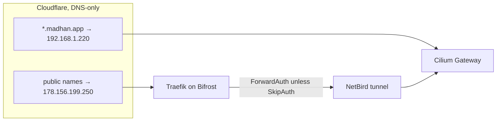

import { Steps } from '@astrojs/starlight/components';

Every service is LAN-only by default: the Cloudflare wildcard `*.madhan.app` points at the private Gateway IP. A service becomes public only when it is listed in `publicServices` in [`cloudflare.go`](src:core/cloud/cloudflare.go).

## How it fits



All records are DNS-only (not proxied). A specific record beats the wildcard, so deleting a service's record is all it takes to make it private again: its name falls back to `192.168.1.220`, which the internet cannot reach.

## What is reachable where

| Name or address | LAN | VPN (NetBird) | Public |
|---|---|---|---|
| `auth`, `netbird`, `uptime`, `proxy`, `*.proxy` | Yes | Yes | Yes, served by Bifrost itself |
| `grafana` | Yes | Yes | Yes, Grafana's own Authentik login (`SkipAuth: true`) |
| `argocd`, `hubble` (Pulumi HTTPRoutes) | Yes | Yes | No |
| `longhorn`, `openbao`, `harbor`, `n8n`, `headlamp`, `falco`, `vmselect`, `alertmanager`, `victorialogs`, `kubeflow`, `ollama`, `comfyui` | Yes | Yes | No |
| `192.168.1.225:11434` (Ollama LoadBalancer) | Yes | Yes | No |
| `192.168.1.230` (CS2 LoadBalancer) | Yes | Yes | No |

Hostnames are `<name>.madhan.app`. VPN reach comes from the `192.168.1.0/24` route that `k8s-routing-peer` advertises to the `All` group; the public wildcard record makes the same names resolve off-LAN. ComfyUI ships scaled to zero.

## Make a service public

<Steps>

1. Add it to `publicServices` in [`cloudflare.go`](src:core/cloud/cloudflare.go). Set `SkipAuth: true` only if the app does its own Authentik login.

   ```go title="core/cloud/cloudflare.go" ins={3}
   var publicServices = []PublicService{
       {Name: "grafana", SkipAuth: true},
       {Name: "headlamp"},
   }
   ```

2. Run `just core hetzner up`. It regenerates `traefik/dynamic/public-services.yml` (gitignored) and Traefik hot-reloads the router.

3. Run `just core cloudflare up` to create the A record pointing at `178.156.199.250`.

4. Check: `dig +short headlamp.madhan.app` returns `178.156.199.250`, and an unauthenticated `curl -I https://headlamp.madhan.app` redirects to `auth.madhan.app`.

</Steps>

To make it private again, remove the entry and run the same two commands. Never edit `public-services.yml` or `services.yml` for this; the first is regenerated on every run.

:::note[LAN clients hairpin through Bifrost]
A public name resolves to the VPS for everyone, so LAN browsers also go out to Hetzner and back through the tunnel. A local DNS override to `192.168.1.220` avoids the round trip.
:::

## Temporary sharing

`netbird expose <port>` from any mesh peer publishes `<name>.proxy.madhan.app` through Traefik TCP passthrough and `netbird-proxy`, without DNS changes and without Authentik. See [NetBird](/cloud/netbird/).

## Troubleshooting

### A service is still public after removing it

The A record still exists: run `just core cloudflare up`. Resolvers may cache the old answer until its TTL expires.

### Public name resolves but returns 504

Traefik has the route but cannot reach the Gateway. See [Bifrost troubleshooting](/cloud/bifrost/).
