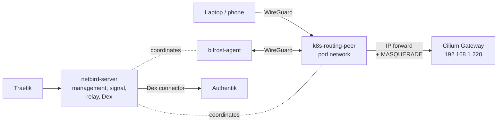

import { Steps } from '@astrojs/starlight/components';

The NetBird server on Bifrost coordinates a WireGuard mesh; an in-cluster routing peer advertises `192.168.1.0/24`, so Bifrost's Traefik and any enrolled laptop or phone reach LAN services. [NetBird docs](https://docs.netbird.io/).

| | |
|---|---|
| Server | `netbird.madhan.app` on [Bifrost](/cloud/bifrost/) |
| Peers | `bifrost-agent` (Docker on Bifrost), `k8s-routing-peer` (StatefulSet, namespace `netbird`) |
| Source | [`netbird/config.yaml`](src:core/cloud/bifrost/netbird/config.yaml), [`bootstrap.sh`](src:core/cloud/bifrost/bootstrap.sh), [`netbird_peer.go`](src:workloads/networking/netbird_peer.go) |
| Auth | Embedded Dex, Authentik as upstream connector |

## How it fits



The routing peer floats to any worker. Forwarded packets leave the pod's `eth0` and Cilium load-balances them on the peer's own node; the hop-by-hop path is in [Traffic](/concepts/traffic/). Peer details live on [NetBird peer](/workloads/networking/netbird-peer/).

### Embedded Dex is the issuer

The combined server always runs embedded Dex, so every JWT NetBird validates is signed by Dex. `auth.issuer` must stay `https://netbird.madhan.app/oauth2`; pointing it at Authentik makes Dex claim Authentik's identity while signing with its own keys, and logins fail with `unable to find appropriate key`. Authentik is a connector inside Dex, added in the UI.

## Configuration

| Setting | Value | Why |
|---|---|---|
| `auth.issuer` | `https://netbird.madhan.app/oauth2` | Embedded Dex; see above |
| Dashboard client | `netbird-dashboard`, public, no secret | Hard-coded static client in Dex |
| `reverseProxy.trustedHTTPProxies` | `172.30.0.10/32` | Traefik's fixed IP in `bifrost_net` |
| `store.engine` | `sqlite`, encrypted with `NB_DATA_STORE_KEY` | |
| `dataDir` | `/var/lib/netbird` | Peer and server state; see the caution below |
| Traefik routers | gRPC (`/signalexchange…`, `/management…`) as h2c; `/relay`, `/ws-proxy/`, `/api`, `/oauth2` as HTTP; everything else to the dashboard | Defined in [`services.yml`](src:core/cloud/bifrost/traefik/dynamic/services.yml) |
| STUN | UDP 3478, published by `netbird-server` | Bypasses Traefik |

:::caution[NetBird does not expand variables in config.yaml]
The file is read verbatim. `bootstrap.sh` substitutes `${NB_RELAY_SECRET}` and `${NB_DATA_STORE_KEY}` with `sed`, and `${NB_OWNER_HASH}` (a bcrypt hash of `NB_OWNER_PASSWORD`) with Python, because the hash contains `$` and `/`. Each run restores the template first, so substitution is idempotent.
:::

:::caution[Config path is `/var/lib/netbird/`]
Both peers persist their WireGuard private key there: a Docker volume on Bifrost, a PVC on the routing peer. Mount anything else (such as `/etc/netbird/`) and every restart registers a new peer, leaving the Network Route pointing at a dead one.
:::

:::danger[Never set `NB_SKIP_SOCKET_MARK=true` on the routing peer]
The routing peer adds a host route for the management server (`178.156.199.250 via 127.0.0.1 dev lo`) so management traffic does not loop through WireGuard. Its own sockets bypass that route by fwmark. Disable the mark and the relay connection breaks: `wt0` carries 0 bytes and every public route goes dark.
:::

### Secrets

| Key | Store | Purpose | Rotate |
|---|---|---|---|
| `NB_DATA_STORE_KEY` | SOPS | SQLite encryption key | Never: the database is encrypted with it |
| `NB_RELAY_SECRET` | SOPS | Relay auth | Yes; all peers reconnect |
| `NB_OWNER_PASSWORD` | SOPS | Local admin `admin@madhan.app` in Dex | After the Authentik connector works |
| `NETBIRD_CLIENT_SECRET` | SOPS | Dex → Authentik connector | Yes |
| `NB_PROXY_TOKEN` | SOPS | `netbird-proxy` access token | Yes |
| `NB_BIFROST_SETUP_KEY` | SOPS | Enrols `bifrost-agent` | Yes |
| `NETBIRD_SETUP_KEY` | OpenBao `secret/netbird` | Enrols `k8s-routing-peer` via the CSI driver | Yes |

Setup keys are used only on first registration; after that each peer reuses its persisted key. Both peers may share one reusable key value.

## First-time setup

Run after the first `just core hetzner up` has all containers healthy.

<Steps>

1. Open `https://netbird.madhan.app` and sign in as `admin@madhan.app` with `NB_OWNER_PASSWORD`.

2. **Settings → Identity Providers → Add → Authentik**:

   | Field | Value |
   |---|---|
   | Client ID | `aumenijDycfG1cQURqH9BNJpV3KVUCoMHGPUVUlT` |
   | Client secret | `NETBIRD_CLIENT_SECRET` from SOPS |
   | Issuer | `https://auth.madhan.app/application/o/netbird/` |

   The redirect URI shown must be `https://netbird.madhan.app/oauth2/callback`; `just core authentik up` already registered it. Test a GitHub login.

3. Create credentials: **Settings → Access Tokens** (for `NB_PROXY_TOKEN`), and two reusable **Setup Keys**, `bifrost-agent` and `k8s-routing-peer`.

4. Store the Bifrost values and redeploy, which starts `netbird-agent` and `netbird-proxy`:

   ```sh frame="terminal"
   sops edit secrets/bootstrap.sops.yaml   # add NB_PROXY_TOKEN, NB_BIFROST_SETUP_KEY
   just core hetzner up
   ```

5. Store the routing peer's key in OpenBao:

   ```sh frame="terminal"
   export ROOT_TOKEN=$(just openbao-token)
   printf '%s\n%s' "$ROOT_TOKEN" '<k8s-routing-peer key>' | kubectl exec -i -n openbao openbao-0 -c openbao -- \
     sh -c 'read -r BAO_TOKEN; export BAO_TOKEN; exec bao kv patch -mount=secret netbird NETBIRD_SETUP_KEY=-'
   just openbao-revoke
   ```

6. Wait for the peer to connect: `kubectl exec -n netbird netbird-peer-0 -- netbird status` shows `Management: Connected`.

7. Under **Peers**, delete any stale `k8s-routing-peer` duplicates so exactly one remains.

8. **Network Routes → Add Route**: network `192.168.1.0/24`, routing peer `k8s-routing-peer`, distribution group `All`. `bifrost-agent` must be in `All` to receive the route.

9. Verify from Bifrost:

   ```sh frame="terminal"
   ssh root@178.156.199.250 'docker exec netbird-agent netbird routes list'   # 192.168.1.0/24 Selected
   ssh root@178.156.199.250 'curl -s -o /dev/null -w "%{http_code}\n" -H "Host: grafana.madhan.app" http://192.168.1.220/'
   ```

</Steps>

## Operate

```sh frame="terminal"
netbird up --management-url https://netbird.madhan.app   # enrol a laptop
netbird expose 8080                                      # temporary <name>.proxy.madhan.app
kubectl exec -n netbird netbird-peer-0 -- netbird status
```

`netbird expose` goes through Traefik TCP passthrough to `netbird-proxy`, which gets its own ACME certificate; it bypasses Authentik.

## Troubleshooting

### Public routes return 504 after the routing peer restarted

The Network Route points at a stale peer entry. Delete disconnected `k8s-routing-peer` duplicates under **Peers** and reassign the route.

### Login fails with `unable to find appropriate key`

`auth.issuer` points somewhere other than embedded Dex. Restore `https://netbird.madhan.app/oauth2`.

### `wt0` exists but carries 0 bytes

`NB_SKIP_SOCKET_MARK` was set on the routing peer. Remove it. For other tunnel problems see [NetBird peer](/workloads/networking/netbird-peer/).
