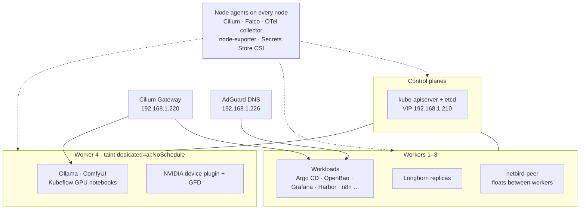

import { totals } from '../../../data/cluster';

The cluster has {totals.nodes} Talos VMs on one Proxmox host: {totals.controlPlanes} control planes and {totals.workers} workers, one of which carries the GPU. Specs per node are on [Cluster nodes](/hardware/nodes/), generated from [`config.yml`](src:config/config.yml).

## Roles

| Role | Nodes | Runs |
|---|---|---|
| Control plane | `k8s-controller1`–`3` | etcd and the API server behind the Talos VIP `192.168.1.210:6443`; only DaemonSets that tolerate the control-plane taint |
| Worker | `k8s-worker1`–`3` | All general workloads and Longhorn replicas |
| GPU worker | `k8s-worker4` | GPU workloads only, plus node-level DaemonSets |

The three role patches are inline in [`talos.go`](src:core/platform/talos.go): control planes get the VIP, workers get the Longhorn disk label, kernel modules for iSCSI/NBD and eviction thresholds, and worker4 adds the NVIDIA modules and a taint. See [Talos](/platform/talos/).

## What runs where

| Placement rule | How | Source |
|---|---|---|
| Keep general pods off worker4 | Talos taint `dedicated=ai:NoSchedule` | [`talos.go`](src:core/platform/talos.go) |
| Put GPU pods on worker4 | `nodeSelector: nvidia.com/gpu.present: "true"` (label set by GFD), toleration for `dedicated=ai`, `runtimeClassName: nvidia` | [`ollama.go`](src:workloads/ai/ollama.go), [`comfyui.go`](src:workloads/ai/comfyui.go) |
| Node agents everywhere | Toleration `operator: Exists` | [`falco.go`](src:workloads/security/falco.go), [`otel_collector.go`](src:workloads/observability/otel_collector.go), [`csi_driver.go`](src:workloads/secrets/csi_driver.go) |
| Longhorn off control planes | `longhorn-manager` has no control-plane toleration, so control planes never register as Longhorn nodes | [`longhorn.go`](src:workloads/storage/longhorn.go) |
| NetBird peer anywhere | No `nodeSelector`; replies return via MASQUERADE, not a fixed route | [`netbird_peer.go`](src:workloads/networking/netbird_peer.go) |

GPU sharing and the device plugin are covered in [GPU](/hardware/gpu/).

## Networking inside the cluster

Cilium is the CNI and replaces kube-proxy; it also implements Gateway API and announces LoadBalancer IPs over L2 from the `192.168.1.220`–`230` pool. Talos ships with no CNI and kube-proxy disabled so Cilium owns both. See [Cilium](/platform/cilium/) and [How traffic flows](/concepts/traffic/).
