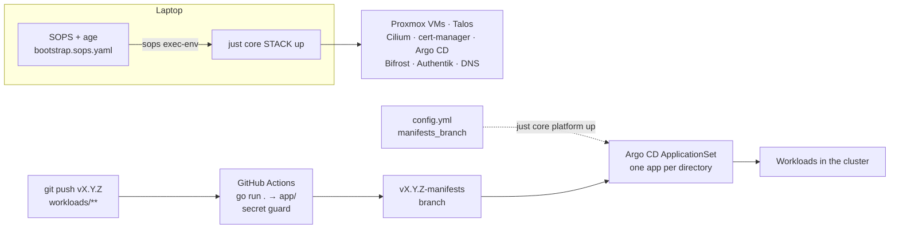

Two paths share one repository. Pulumi changes infrastructure and runs only from a laptop; workload changes go through CI and Argo CD. Why the split: [GitOps with Pulumi and CDK8s](/reference/decisions/gitops-cdk8s/).

## Infrastructure path: Pulumi

`just core <stack> up` wraps `pulumi up` in `sops exec-env`, so bootstrap secrets exist only as environment variables for that one command. It never runs in CI. Source: [`main.go`](src:core/main.go), [`justfile`](src:justfile).

| Stack | Manages |
|---|---|
| `talos` | Proxmox VMs, Talos machine configs, cluster bootstrap |
| `platform` | Gateway API CRDs, Cilium, the Gateway, cert-manager, Argo CD and its ApplicationSet, the LB IP pool |
| `hetzner` | Bifrost VPS, its env files and `bootstrap.sh` |
| `authentik` | Authentik OIDC apps, GitHub OAuth, ForwardAuth outpost |
| `cloudflare` | DNS records |

## Workload path: CDK8s, CI and Argo CD

[CDK8s](/platform/cdk8s/) turns Go in `workloads/` into YAML: `just synth` writes one directory per app under `app/` (gitignored). On a push that touches `workloads/**`, [`cdk8s-seal-publish.yml`](src:.github/workflows/cdk8s-seal-publish.yml):

1. Runs `go run .` in `workloads/` and builds the Kubeflow kustomization into `app/kubeflow/`.
2. Runs [`manifest-secret-guard.sh`](src:scripts/manifest-secret-guard.sh), which fails on any rendered Secret payload not on the allowlist.
3. Force-publishes `app/` to the branch `<source branch>-manifests`.

The [Argo CD](/platform/argocd/) ApplicationSet `cots-applications` ([`argocd.go`](src:core/platform/argocd.go)) uses a git directory generator on that branch: each top-level directory becomes an Application of the same name, deployed to the namespace of the same name.

| Sync setting | Value | Why |
|---|---|---|
| `ServerSideApply=true` | always | Large CRDs exceed the client-side `last-applied-configuration` annotation limit |
| `CreateNamespace=true` | always | The directory name is the namespace |
| `automated: prune, selfHeal` | unless `argocd_manual_sync: true` | Manual mode lets a release roll out one app at a time with `just argocd-sync <app>` |

## Release branches

The cluster deploys from a release branch, not `main`.

| Step | What happens |
|---|---|
| Cut `vX.Y.Z` | Creating the branch triggers CI even without a `workloads/` change, so `vX.Y.Z-manifests` exists before anything points at it |
| Set `manifests_branch: vX.Y.Z-manifests` in [`config.yml`](src:config/config.yml) | The single switch for what the cluster runs |
| `just core platform up` | Repoints the ApplicationSet; Argo CD syncs the new branch |

Pushes to `main` also publish `main-manifests`, but nothing syncs it unless `manifests_branch` names it.

:::caution[Create the manifests branch before switching]
If `manifests_branch` names a branch that does not exist yet, every Application loses its source at once. Let CI publish the branch first, then run `just core platform up`.
:::

## What to change where

| Change | Edit | Apply |
|---|---|---|
| App version or config | `workloads/<group>/<app>.go` | push to the release branch |
| Public exposure | `publicServices` in [`cloudflare.go`](src:core/cloud/cloudflare.go) | `just core cloudflare up`, then `just core hetzner up` |
| Node count or size | [`config.yml`](src:config/config.yml) | `just core talos up` |
| Cilium, Gateway, Argo CD | `core/platform/*.go` | `just core platform up` |
| Authentik apps | [`authentik.go`](src:core/cloud/authentik.go) | `just core authentik up` |
