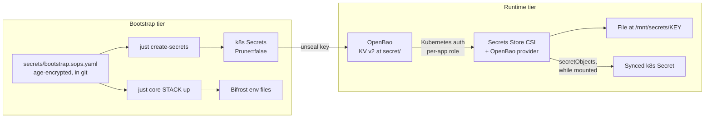

Bootstrap secrets are what the platform needs before OpenBao exists; they live age-encrypted in git. Every other secret lives in OpenBao and reaches pods through the Secrets Store CSI driver. Why two tiers: [Two-tier secrets](/reference/decisions/secrets-two-tier/).

## Bootstrap tier: SOPS and age

`secrets/bootstrap.sops.yaml` holds the provider tokens, the Authentik and NetBird keys for Bifrost, and the OpenBao unseal key. Recipes decrypt it per command with `sops exec-env`; nothing decrypted is written to the repo. Pulumi passes the Bifrost keys into one env file per container (see [Bifrost](/cloud/bifrost/)). [`create-bootstrap-secrets.sh`](src:scripts/create-bootstrap-secrets.sh), run by `just create-secrets`, creates the only two in-cluster bootstrap Secrets:

| Secret | Namespace | Used by |
|---|---|---|
| `openbao-unseal-key` | `openbao` | The OpenBao unseal sidecar |
| `cloudflare-api-token` | `cert-manager` | DNS-01 challenges for the wildcard certificate |

Both carry `argocd.argoproj.io/sync-options: Prune=false`, so Argo CD never deletes Secrets it did not create.

## Runtime tier: OpenBao and the CSI driver

Each app has a SecretProviderClass, built by `kit.SecretProviderClass` in [`kit.go`](src:workloads/kit/kit.go). It reads keys from `secret/data/<app>` using the OpenBao Kubernetes auth role of the same name, bound to the app's ServiceAccount. `just openbao-setup` creates the auth method, policies and roles once; see [OpenBao](/workloads/secrets/openbao/) and [Secrets Store CSI Driver](/workloads/secrets/csi-driver/).

| Pattern | When | Apps |
|---|---|---|
| File only | The app can read a value from a file; no Secret object exists | Grafana admin password (`$__file{}` in an env var) |
| Synced Secret | The chart wants an `existingSecret` or the app reads only env vars | Grafana OIDC client secret, Harbor, n8n, NetBird peer, Falco (Sidekick UI), CS2, Homepage, Headlamp |

Prefer file-only: the value never appears in `kubectl get secret`.

:::caution[The CSI mount is what creates the Secret]
A SecretProviderClass fetches nothing on its own, and `secretObjects` creates nothing until a running pod mounts the CSI volume. Charts that cannot add volumes (Harbor, Falco) get a `secret-sync` pause pod from `kit.SecretSync` whose only job is to hold that mount open. "The Secret was never created" almost always means no pod mounts the volume.
:::

## Unsealing OpenBao

OpenBao seals itself on every restart. An `unseal` container in `extraContainers` ([`openbao.go`](src:workloads/secrets/openbao.go)) reads `openbao-unseal-key` and loops `bao operator unseal` against `127.0.0.1:8200`. It is a sidecar, not an init container, because unseal requests need the server already running. The very first initialisation is manual: `just openbao-init`.

## Rules

| Rule | Enforced by |
|---|---|
| Workload code declares no `Secret` objects | Convention in `workloads/`; secrets come from OpenBao |
| No new Secret payload in published manifests | CI [`manifest-secret-guard.sh`](src:scripts/manifest-secret-guard.sh); its [allowlist](src:scripts/manifest-secret-allowlist.txt) of chart-rendered Secrets may only shrink |
| No root token at rest | `just openbao-root` generates one per command from the unseal key and revokes it on exit |
| CI needs no repository secrets beyond its own `GITHUB_TOKEN` | Synthesis reads nothing secret |
