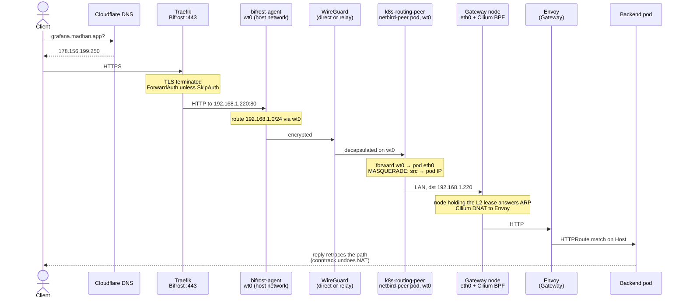
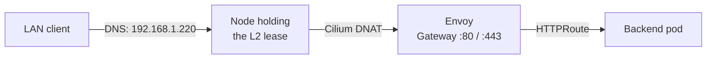
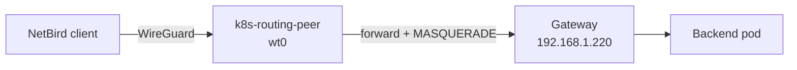

import { Tabs, TabItem } from '@astrojs/starlight/components';
import JourneyDiagram from '../../../components/arch/JourneyDiagram.astro';

Every path ends at the same Cilium Gateway (`192.168.1.220`); they differ in how a packet reaches it. DNS decides which path a hostname takes.

<JourneyDiagram />

## DNS split

Cloudflare holds the records, all DNS-only (not proxied). Source: [`cloudflare.go`](src:core/cloud/cloudflare.go).

| Record | Points to | Path |
|---|---|---|
| `*.madhan.app` | `192.168.1.220` (Gateway LB IP) | LAN or VPN only |
| `auth`, `netbird`, `proxy`, `uptime`, `*.proxy` | `178.156.199.250` (Bifrost) | Served by containers on the VPS |
| each entry in `publicServices` | `178.156.199.250` (Bifrost) | Public, tunnelled to the cluster |

To make a cluster service public, add it to `publicServices`; see [Service exposure](/cloud/exposure/).

## The three paths

<Tabs>
<TabItem label="Public internet">

Traefik on Bifrost terminates TLS and proxies plain HTTP to `http://192.168.1.220`. The host's NetBird agent routes the LAN subnet into the WireGuard mesh, so that address is reachable from the VPS.

| Hop | Detail | Source |
|---|---|---|
| Traefik | File provider only; public routers are generated into `public-services.yml` from `publicServices` | [`hetzner.go`](src:core/cloud/hetzner.go) |
| bifrost-agent | `netbird-agent` container, `network_mode: host`, peer name `bifrost-agent` | [`docker-compose.yml`](src:core/cloud/bifrost/docker-compose.yml) |
| k8s-routing-peer | `netbird-peer` StatefulSet in pod networking, no `nodeSelector`: it runs on whichever worker the scheduler picks | [`netbird_peer.go`](src:workloads/networking/netbird_peer.go) |
| MASQUERADE | Init container adds `POSTROUTING ! -o wt0 -d 192.168.1.0/24 -j MASQUERADE` | [`netbird_peer.go`](src:workloads/networking/netbird_peer.go) |
| Cilium | Datapath on `ens18`/`eth0` only; L2 announcement of the LB pool | [`cilium.go`](src:core/platform/cilium.go) |

Replies need no route back to the overlay. MASQUERADE rewrites the source to the peer's pod IP, Cilium load-balances the packet from the pod's `eth0` (so it works on the L2 lease holder too), and conntrack in the pod reverses the NAT and returns the reply into `wt0`. Nodes carry only a default route ([`talos.go`](src:core/platform/talos.go)), which is why the peer can float between workers.

:::danger[Never add wt0 to Cilium devices]
`wt0` is a NOARP/POINTOPOINT WireGuard interface with no Ethernet header. Cilium's TC BPF program expects Ethernet frames, so on `wt0` it misparses every packet and drops it without a single monitor event, and the public path dies silently. Packets from `wt0` must instead leave through the kernel to the LAN NIC of the node that owns the Gateway IP, where Cilium runs on a real Ethernet interface.
:::

</TabItem>
<TabItem label="LAN">

A LAN client resolves `*.madhan.app` to `192.168.1.220` and talks to the Gateway directly — no VPS, no ForwardAuth.

The Gateway `homelab-gateway` (namespace `kube-system`) listens on HTTP `:80` and HTTPS `:443`; HTTPS terminates with the wildcard certificate from [cert-manager](/platform/cert-manager/). Cilium hands out LB addresses from `192.168.1.220`–`230`, skipping any that are node IPs.

A public service resolves to Bifrost even on the LAN, so LAN clients hairpin through the VPS unless local DNS overrides the record — see [Service exposure](/cloud/exposure/).

</TabItem>
<TabItem label="VPN (NetBird)">

A NetBird client anywhere joins the mesh through `netbird.madhan.app`, which is served on Bifrost. The k8s-routing-peer advertises `192.168.1.0/24`, so the client reaches the Gateway and every LAN-only hostname as if it were at home.

The route is assigned to the peer in the NetBird UI, not in code. The datapath from `wt0` onward is the same as the public path. See [NetBird](/cloud/netbird/).

</TabItem>
</Tabs>

## When the public path breaks

A 504 from a public URL means Traefik is up but cannot reach the Gateway. The runbook is on [NetBird peer](/workloads/networking/netbird-peer/).
