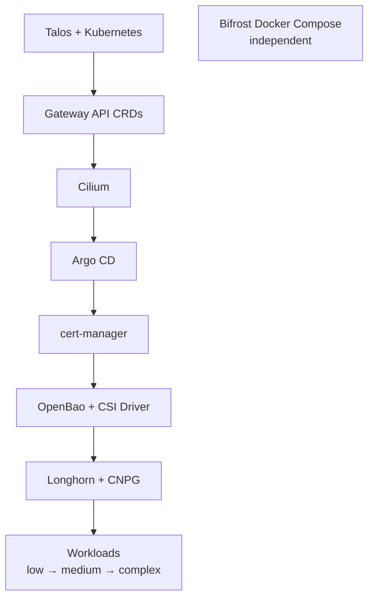

import { Aside } from '@astrojs/starlight/components';

Upgrade one layer at a time, bottom up: each layer needs the one below it stable. Current pins live in the [Software Inventory](/reference/software-inventory/).

## Order



| Phase | Component | Risk | Page |
|---|---|---|---|
| 1 | Talos, Kubernetes | High — rolling node reboots | [Talos](/operate/upgrades/talos/) |
| 2 | Gateway API CRDs, Cilium | High — CNI restart, LB IPs can go dark | [Cilium](/operate/upgrades/cilium/) |
| 3 | Argo CD | Medium — GitOps paused during restart | [Argo CD](/operate/upgrades/argocd/) |
| 4 | cert-manager | Low, but TLS for every service | [cert-manager](/operate/upgrades/cert-manager/) |
| 5 | OpenBao, Secrets Store CSI Driver | Medium — every app reads secrets here | [Secrets](/operate/upgrades/secrets/) |
| 6 | Longhorn, CloudNativePG | Medium — storage disruption | [Storage](/operate/upgrades/storage/) |
| 7 | Bifrost (Traefik, NetBird, Authentik) | Low — outside the cluster | [Bifrost](/operate/upgrades/bifrost/) |
| 8–10 | Workloads | Low to complex | [Workloads](/operate/upgrades/workloads/) |
| — | CDK8s typed imports | After any `cdk8s.yaml` bump | [CDK8s imports](/operate/upgrades/cdk8s-imports/) |

Known breaking changes per component: [Breaking changes](/operate/upgrades/breaking-changes/).

<Aside type="caution" title="Where pins live">
Most pins are in [`config/versions.yaml`](src:config/versions.yaml). Charts with a generated typed package are in [`workloads/cdk8s.yaml`](src:workloads/cdk8s.yaml); Bifrost images in [`docker-compose.yml`](src:core/cloud/bifrost/docker-compose.yml); Kubeflow in its `kustomization.yaml`. Run `just docs-check` after any bump.
</Aside>

## Phase 0: research versions

Run before touching anything and note the results.

```bash title="Latest releases" collapse={9-23}
curl -s https://api.github.com/repos/siderolabs/talos/releases/latest | jq -r .tag_name
helm repo add cilium https://helm.cilium.io && helm search repo cilium/cilium --versions | head -3
helm repo add argo https://argoproj.github.io/argo-helm && helm search repo argo/argo-cd --versions | head -3

# Workload chart repos, then the latest two versions of each
while read -r name url; do
  helm repo add "$name" "$url" >/dev/null
done <<'REPOS'
longhorn       https://charts.longhorn.io
vm             https://victoriametrics.github.io/helm-charts
grafana        https://grafana-community.github.io/helm-charts
harbor         https://helm.goharbor.io
openbao        https://openbao.github.io/openbao-helm
csi-driver     https://kubernetes-sigs.github.io/secrets-store-csi-driver/charts
headlamp       https://kubernetes-sigs.github.io/headlamp
kyverno        https://kyverno.github.io/kyverno
trivy          https://aquasecurity.github.io/helm-charts
otel           https://open-telemetry.github.io/opentelemetry-helm-charts
ollama         https://otwld.github.io/ollama-helm
reloader       https://stakater.github.io/stakater-charts
cnpg           https://cloudnative-pg.github.io/charts
metrics-server https://kubernetes-sigs.github.io/metrics-server
falco          https://falcosecurity.github.io/charts
REPOS
helm repo update >/dev/null

for chart in longhorn/longhorn vm/victoria-metrics-k8s-stack vm/victoria-logs-single \
  grafana/grafana harbor/harbor openbao/openbao csi-driver/secrets-store-csi-driver \
  headlamp/headlamp kyverno/kyverno trivy/trivy-operator otel/opentelemetry-collector \
  ollama/ollama reloader/reloader cnpg/cloudnative-pg metrics-server/metrics-server falco/falco; do
  echo "=== $chart ===" && helm search repo "$chart" --versions | head -2
done

# Bifrost images
curl -s https://api.github.com/repos/netbirdio/netbird/releases/latest | jq -r .tag_name
curl -s https://api.github.com/repos/goauthentik/authentik/releases/latest | jq -r .tag_name
curl -s https://api.github.com/repos/traefik/traefik/releases/latest | jq -r .tag_name
```

`helm search repo` compares chart versions. A chart can lag the app it ships, so check the APP column too. Read the upstream issue tracker for the target release before bumping.

## Post-upgrade verification

```bash frame="terminal"
just talos-health
kubectl get applications -n argocd                    # all Synced + Healthy

# Secrets
kubectl exec -n openbao openbao-0 -c openbao -- bao status   # Sealed: false
kubectl exec -n harbor deploy/secret-sync -- ls /mnt/secrets/

# Storage
kubectl get volumes.longhorn.io -n longhorn-system \
  -o custom-columns=NAME:.metadata.name,STATE:.status.state,ROBUST:.status.robustness
kubectl get cluster -A                                # CNPG healthy

# GPU
kubectl get node k8s-worker4 -o jsonpath='{.status.allocatable.nvidia\.com/gpu}'   # 5
kubectl exec -n ollama deploy/ollama -- nvidia-smi

# Edge
curl -I https://auth.madhan.app
curl -I https://grafana.madhan.app
ssh root@178.156.199.250 docker exec netbird-agent netbird status
```
