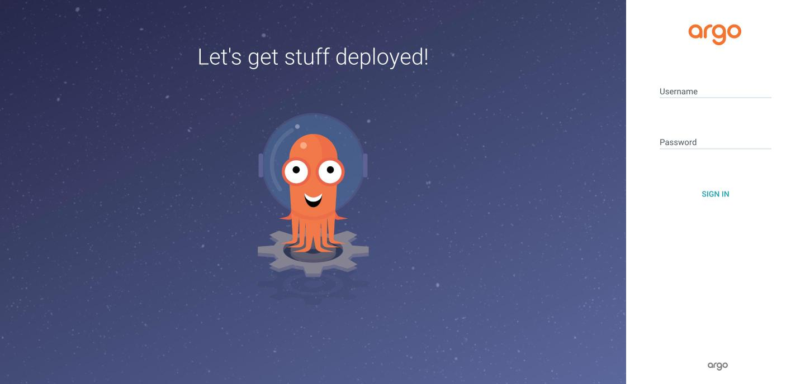

Argo CD deploys every workload from the CDK8s output on the `v0.1.8-manifests` branch; Pulumi installs it once and creates the ApplicationSet. [Argo CD docs](https://argo-cd.readthedocs.io/).

| | |
|---|---|
| Namespace | `argocd` |
| Source | [`argocd.go`](src:core/platform/argocd.go), stack `platform` |
| Exposure | LAN · `argocd.madhan.app` (also `argocd.local`) |
| Branch | `manifests_branch` in [`config.yml`](src:config/config.yml) |
| Why | [GitOps with Pulumi and CDK8s](/reference/decisions/gitops-cdk8s/) |

<!-- TODO screenshot: Argo CD application list with sync and health status -->



## How it fits

ApplicationSet `cots-applications` uses a git directory generator over `*` on the manifests branch: each top-level directory becomes an Application named after it and deployed to the namespace of the same name. The full pipeline is in [GitOps](/concepts/gitops/).

## Configuration

| Setting | Value | Why |
|---|---|---|
| Sync | `automated: {prune, selfHeal}` unless `argocd_manual_sync: true` | Git is the only way to change the cluster; manual mode allows app-by-app rollout |
| `ServerSideApply=true` | ApplicationSet sync option | Large CRDs exceed the 262 KB last-applied annotation limit |
| `CreateNamespace=true` | ApplicationSet sync option | Namespaces follow directory names |
| Image tag | Ahead of the chart's default | Fixes server-side diff reporting fields removed by other managers as drift; drop once a chart ships it |
| `server.insecure` | `true`, Service `ClusterIP` | TLS terminates at the Gateway |
| `global.networkPolicy.create` | `false` | Chart default flipped to true; Cilium would enforce unreviewed policies |
| Repo server timeouts | `KUSTOMIZE_REMOTE_FETCH_TIMEOUT=180`, `reposerver.exec.timeout: 180s` | The Kubeflow manifests repo is too large for the defaults |

### ignoreDifferences

| Where | Resource | Fields | Why |
|---|---|---|---|
| `argocd-cm` (global) | StatefulSet | `volumeClaimTemplates[].apiVersion`, `.kind`, `.spec.volumeMode` | CDK8s omits them; the API server adds them |
| `argocd-cm` (global) | ClusterRole | `.rules` | Aggregated Kubeflow roles are filled in by Kubernetes |
| `argocd-cm` (global) | CustomResourceDefinition | `.spec.conversion`, `.spec.preserveUnknownFields`, `.status` | Mutated after apply |
| ApplicationSet | VictoriaMetrics operator Secret and webhook | `/data`, `caBundle` | Regenerated on every operator restart |

:::caution[StatefulSet VCT drift needs the global rule]
With server-side diff, per-Application `jqPathExpressions` apply only to the dry-run result, not the live object, so StatefulSet VCT fields stay OutOfSync. The `resource.customizations.ignoreDifferences.apps_StatefulSet` entry in `argocd-cm` strips them from both sides.
:::

Bootstrap Secrets `openbao/openbao-unseal-key` and `cert-manager/cloudflare-api-token` carry `Prune=false` so Argo CD never deletes them.

## Operate

```sh frame="terminal"
just core platform up                  # Argo CD and ApplicationSet changes
just argocd-sync <app>                 # one app, used while argocd_manual_sync is true
kubectl get applications -n argocd
```

## Troubleshooting

### A manual kubectl change keeps reverting

`selfHeal` restores git state within minutes. Change the code instead.

### StatefulSet permanently OutOfSync

The diff is on VCT fields not covered by the global rule. Add them to `apps_StatefulSet` in `argocd.go`, not to the Application.

### Deployment sync fails with an immutable selector error

A chart change altered `spec.selector`. Delete the Deployment once and let Argo CD recreate it.

### Bootstrap Secret deleted

Run `just create-secrets`.
