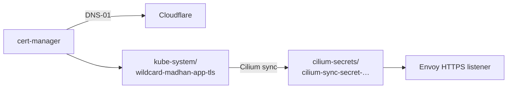

cert-manager issues and renews the single certificate that terminates HTTPS on the Gateway. DNS-01 through Cloudflare means the cluster needs no public HTTP endpoint. [cert-manager docs](https://cert-manager.io/docs/).

| | |
|---|---|
| Namespace | `cert-manager` |
| Source | [`cert_manager.go`](src:core/platform/cert_manager.go), stack `platform` |
| Certificate | `kube-system/wildcard-madhan-app` → Secret `wildcard-madhan-app-tls` |
| Secret input | `cert-manager/cloudflare-api-token`, key `CLOUDFLARE_API_TOKEN` |

## How it fits



Envoy reads TLS from `cilium-secrets`, and Cilium copies the secret there itself (`gatewayAPI.secretsNamespace.sync` in [`cilium.go`](src:core/platform/cilium.go)) and owns the copy.

## Configuration

| Setting | Value | Why |
|---|---|---|
| CRDs | `installCRDs: true` | Installed with the chart |
| `letsencrypt-prod` | ACME DNS-01, Cloudflare, zone `madhan.app` | The wildcard certificate |
| `homelab-ca` | Self-signed ClusterIssuer | Internal and test certificates |
| DNS names | `madhan.app`, `*.madhan.app` | One certificate for every route |
| Cloudflare token scope | Zone:Read, DNS:Edit on `madhan.app` | Find the zone; write `_acme-challenge` TXT records |

The token Secret is created by `just create-secrets` from SOPS and carries `argocd.argoproj.io/sync-options: Prune=false`. Nothing issues until it exists.

:::danger[Never add a second Certificate for the same names]
Let's Encrypt allows 5 certificates per exact identifier set per 168 hours. A second Certificate shares that budget, and one written into `cilium-secrets` is removed by Cilium and reissued until the limit is hit. Then no certificate exists and every HTTPS route resets while HTTP still returns 200.
:::

## Operate

```sh frame="terminal"
just create-secrets             # Cloudflare token from SOPS
just core platform up
kubectl get certificate -A      # expect Ready=True
kubectl get secret -n cilium-secrets
```

## Proxmox host certificate

The Proxmox UI at `pve.madhan.app:8006` does not go through cert-manager. The talos stack ([`proxmox.go`](src:core/platform/proxmox.go)) sets up Proxmox's own ACME client with the same Cloudflare token and orders the certificate once. Proxmox then renews it itself. The `pve` A record points at the host on the LAN ([`cloudflare.go`](src:core/cloud/cloudflare.go)).

The same stack adds the `authentik` login realm (the default on the login form). Users are created on first login from their GitHub username; Authentik's `grafana-admins` syncs in as group `grafana-admins-authentik`, which holds `Administrator` on `/`. `root` with realm **Linux PAM** remains the fallback.

## Troubleshooting

### Certificate not Ready

Read the `Issuing` condition with `kubectl describe certificate wildcard-madhan-app -n kube-system`, then `kubectl logs -n cert-manager deploy/cert-manager | grep -i cloudflare`. A missing token Secret is the usual cause.

### `429 too many certificates already issued for this exact set of identifiers`

The weekly budget is spent; the message gives the retry time. Do not delete and recreate the Certificate, which spends more. Find what issues duplicates first.

### Certificate `Revision` in the dozens

Something keeps deleting its Secret and cert-manager keeps reissuing. That is the failure in the danger note above.
