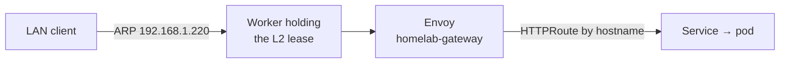

Cilium is the CNI, replaces kube-proxy, announces LoadBalancer IPs over ARP, and runs the one Gateway every HTTPRoute attaches to. [Cilium docs](https://docs.cilium.io/).

| | |
|---|---|
| Namespace | `kube-system` |
| Source | [`cilium.go`](src:core/platform/cilium.go), stack `platform` |
| Gateway | `homelab-gateway` (`kube-system`), Service `cilium-gateway-homelab-gateway` at `192.168.1.220` |
| Exposure | LAN · `hubble.madhan.app` |
| Why | [Cilium for networking](/reference/decisions/cilium/) |

## How it fits



The Gateway has an HTTP listener on 80 and an HTTPS listener on 443 terminating with `kube-system/wildcard-madhan-app-tls` ([cert-manager](/platform/cert-manager/)). Both accept routes from all namespaces; apps attach with `kit.Route` ([CDK8s](/platform/cdk8s/)).

## Configuration

| Setting | Value | Why |
|---|---|---|
| `kubeProxyReplacement` | `true` | Talos runs no kube-proxy |
| `k8sServiceHost` / `Port` | `192.168.1.210` / `6443` | Without kube-proxy Cilium must reach the API server directly, via the VIP |
| `devices` | `ens18`, `eth0` | Nodes have carried both NIC names across Talos upgrades |
| `bpf.hostLegacyRouting` | `true` | eBPF host routing conflicts with Talos's host DNS forwarding and drops kubelet (10250) and apid (50000) traffic |
| `socketLB.enabled` | `false` | Socket LB hooks interfere with kubelet and apid binding their ports |
| `installNoConntrackIptablesRules` | `false` | NOTRACK plus DROP-INVALID blocks new TCP to host ports |
| `cgroup.autoMount` | `false`, `hostRoot: /sys/fs/cgroup` | Talos mounts cgroups itself |
| `l2announcements.enabled` | `true` | ARP for LoadBalancer IPs, no MetalLB |
| `gatewayAPI.secretsNamespace.sync` | `true` | Cilium owns the TLS copy in `cilium-secrets`; see [cert-manager](/platform/cert-manager/) |
| IP pool `address-pool` | `192.168.1.220`–`230` from `lb_pool`, minus node IPs | Announcing a node's own IP takes that node off the LAN |
| L2 policy `l2-policy` | Workers only, `loadBalancerIPs: true`, `externalIPs: false` | |
| `deny-service-external-ips` | ValidatingAdmissionPolicy | kube-proxy replacement always serves `spec.externalIPs` (CVE-2020-8554); use a LoadBalancer Service |
| `cilium-leases-access` | ClusterRole + binding | L2 leader election needs Lease access the chart does not grant |

The pool range overlaps worker IPs `.221`–`.224`, so only `.220` and `.225`–`.230` are handed out. Fixed assignments use the `lbipam.cilium.io/ips` annotation (Ollama `.225`, CS2 `.230`).

:::danger[Never add wt0 to devices]
NetBird's `wt0` is NOARP/POINTOPOINT; Cilium's TC BPF silently drops its non-Ethernet frames with no monitor events. `wt0` lives inside the `netbird-peer` pod, and tunnel traffic reaches Cilium through the pod's `eth0`. See [Traffic](/concepts/traffic/).
:::

### Gateway API CRDs

The CRDs are vendored in [`core/platform/manifests/`](src:core/platform/manifests/gateway-api-v1.6.3-experimental-install.yaml) and applied before Cilium: the operator enables Gateway support only for CRDs present at start-up. The experimental channel is used for TLSRoute `v1alpha2`. Fetching from the release URL was dropped because a rate-limited response fails the whole stack with an opaque unmarshal error. To upgrade, re-vendor the file and update its path in `cilium.go`. The bundle's `safe-upgrades` admission policy rejects older CRDs; delete it first if you must roll back.

## Operate

```sh frame="terminal"
just core platform up
just gateway-repair-l2          # LAN times out on 192.168.1.220 but in-cluster requests work
kubectl -n kube-system exec ds/cilium -- cilium status | grep KubeProxyReplacement
kubectl get ciliumloadbalancerippool,ciliuml2announcementpolicy
kubectl get leases -n kube-system | grep l2announce
```

Upgrade one Cilium minor at a time; see [Upgrades](/operate/upgrades/).

## Troubleshooting

### LoadBalancer IP stops answering after a Cilium restart

The lease holder keeps renewing but no longer answers ARP. Run `just gateway-repair-l2`, which deletes the lease so another node takes the IP. Details in [Troubleshooting](/operate/troubleshooting/).

### Cilium CrashLoop with exit 137

Deleting the pod does not clear corrupted BPF state. Reboot the node: `talosctl --talosconfig ~/.talos/config reboot --nodes <ip>`. If its datapath is broken the graceful reboot can hang; see [Troubleshooting](/operate/troubleshooting/).
