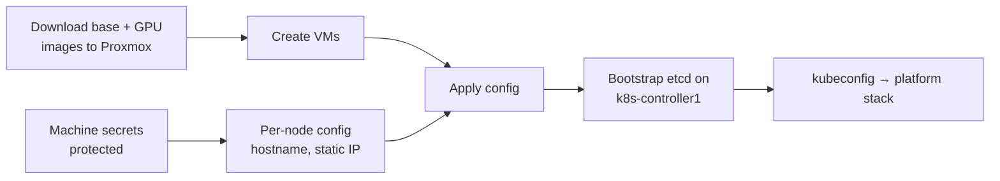

The `talos` stack creates every node as a Proxmox VM and turns them into a Talos Linux cluster named `talos-cluster`. [Talos docs](https://www.talos.dev/).

| | |
|---|---|
| Source | [`talos.go`](src:core/platform/talos.go), [`proxmox.go`](src:core/platform/proxmox.go), [`config.yml`](src:config/config.yml) |
| Versions | Talos, Kubernetes and image schematics in [`versions.yaml`](src:config/versions.yaml); see the [software inventory](/reference/software-inventory/) |
| Endpoint | `https://192.168.1.210:6443` |
| Outputs | `core/talosconfig`, `core/kubeconfig`, stack outputs `talosconfig`, `kubeconfig`, `<node>-ip` |

Node sizes, images and per-role patches are on [Nodes](/hardware/nodes/).

## How it fits



## Configuration

| Setting | Value | Why |
|---|---|---|
| CNI | `none` | Cilium is installed by the `platform` stack |
| kube-proxy | Disabled | Cilium replaces it |
| `install.disk` | `/dev/sda` | Nodes boot with `talos.platform=metal`, whose installer refuses to upgrade without it |
| `install.image` | Unset | `just talos-upgrade` passes the Image Factory installer explicitly |
| `KubernetesVersion` | Pinned | Left unset, the provider's default would roll nodes back on apply |
| Machine secrets | `protect: true` | The provider regenerates the cluster PKI if the Talos version decreases |
| VM image | `ignoreChanges` on the disk's file ID | A newer image must not replace running nodes |

:::danger[Never let a Talos version rollback reach `pulumi up`]
Lowering the Talos version replaces the machine secrets, which means a new cluster PKI.
:::

Configs are applied to the address the QEMU guest agent reports, falling back to the static IP when the VM is stopped so one stopped node does not block the preview.

## Operate

```sh frame="terminal"
just core talos up                       # create or reconfigure nodes
just talos-health
just talos-versions
just talos-upgrade <ip>                  # one node at a time
just talos-upgrade 192.168.1.224 gpu     # worker4 needs the GPU schematic
just talos-upgrade-k8s

cd core && pulumi stack output talosconfig --show-secrets > ~/.talos/config   # refresh a stale talosconfig
```

Upgrade procedures live under [Upgrades](/operate/upgrades/).

## Troubleshooting

### `talosctl` cannot connect or rejects the certificate

The local talosconfig is stale. Refresh it from the stack output above and use endpoint `192.168.1.210`.

### Changing the image did nothing to existing nodes

By design: the image only seeds new VMs. Upgrade in place with `just talos-upgrade <ip>`.
