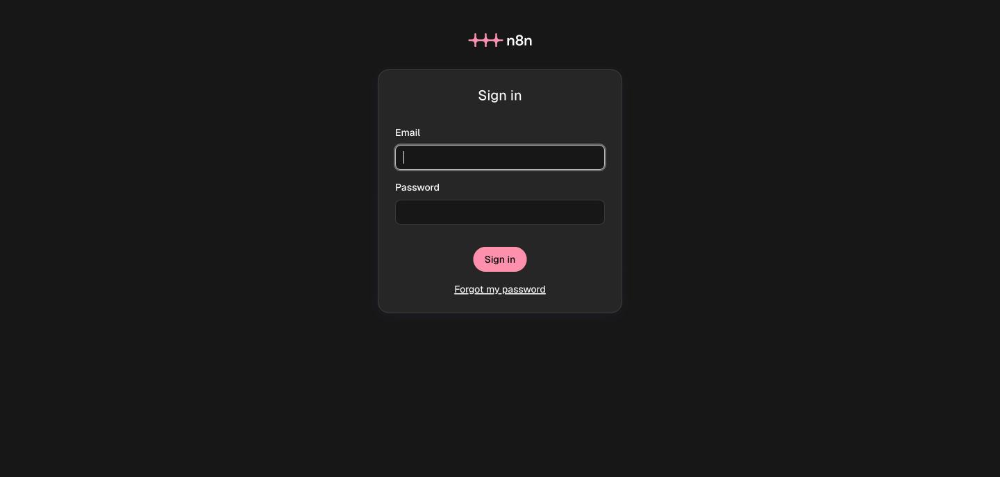
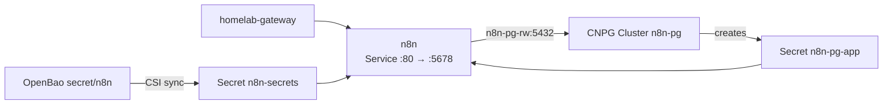

n8n runs scheduled, webhook and event-driven workflows. It uses the [8gears chart](https://github.com/8gears/n8n-helm-chart) and a CloudNativePG database instead of the chart's bundled Postgres. [Upstream docs](https://docs.n8n.io/).

| | |
|---|---|
| Namespace | `n8n` |
| Source | [`n8n.go`](src:workloads/automation/n8n.go) |
| Exposure | LAN · `n8n.madhan.app` |
| Storage | 10Gi RWX on the default `longhorn` class (binary data), plus 10Gi Postgres on `longhorn` |
| Auth | n8n's own login |



## How it fits



## Configuration

| Setting | Value | Why |
|---|---|---|
| `postgresql.enabled` | `false` | Database is the CNPG `Cluster` `n8n-pg`: 1 instance, 10Gi, `initdb` database and owner `n8n` |
| `N8N_ENCRYPTION_KEY` | from `n8n-secrets` (OpenBao key `ENCRYPTION_KEY`) | Encrypts stored workflow credentials |
| `DB_POSTGRESDB_PASSWORD` | from `n8n-pg-app`, key `password` | CNPG owns the credential |
| CSI volume | mounted at `/mnt/secrets` | The mount is what makes the driver create `n8n-secrets` |
| `default_binary_data_mode` | `filesystem` | n8n dropped in-memory binary data; keep it on the PVC |
| `startupProbe` | `/healthz`, 60 × 10s | Major upgrades migrate the database before n8n listens |
| Memory limit | `1Gi` | Covers the Code-node task runner, a child process in the same container |

:::danger[Never change the encryption key]
Saved credentials only decrypt with the key they were stored under. `just openbao-setup` seeds `ENCRYPTION_KEY` once and never replaces it.
:::

## Troubleshooting

### "Credentials could not be decrypted"

The running key differs from the one that stored them. Restore the original `ENCRYPTION_KEY` in OpenBao at `secret/n8n`, or delete and re-enter the credentials.

### Database connection failed

```bash frame="terminal"
kubectl get cluster n8n-pg -n n8n
kubectl get pods -n n8n -l cnpg.io/cluster=n8n-pg
kubectl get secret n8n-pg-app -n n8n
```

### Argo CD sync fails with an immutable selector

A chart change altered the Deployment's `spec.selector`. Delete the Deployment and let Argo CD recreate it:

```bash frame="terminal"
kubectl delete deployment n8n -n n8n
just argocd-sync n8n
```
