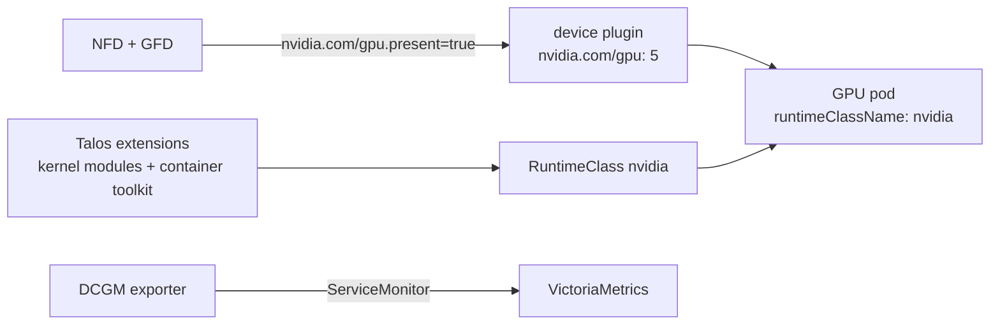

The standalone NVIDIA device plugin advertises `nvidia.com/gpu` on worker4 and splits the card five ways by time-slicing. [Upstream docs](https://github.com/NVIDIA/k8s-device-plugin).

| | |
|---|---|
| Namespace | `nvidia-gpu-operator` (privileged) |
| Source | [`nvidia_gpu_operator.go`](src:workloads/hardware/nvidia_gpu_operator.go) |
| Exposure | — |
| Storage | — |
| Auth | — |

The full GPU Operator is not used: on Talos the driver and container toolkit come from system extensions, and the operator's validator fails on Talos library paths.

## How it fits



## Configuration

| Setting | Value | Why |
|---|---|---|
| RuntimeClass | `nvidia` (handler `nvidia`) | Routes pods through nvidia-container-runtime, the only way to inject NVML on Talos (libraries sit in a squashfs) |
| `deviceDiscoveryStrategy` | `nvml` | `auto` probes standard paths that do not exist on Talos |
| `plugin.deviceListStrategy` | `envvar` | CDI hostPath mounts fail on Talos's non-standard library paths |
| `timeSlicing.replicas` | `5` | Ollama, ComfyUI, a notebook, a training job and a Katib trial |
| NFD, GFD | enabled | GFD sets `nvidia.com/gpu.present=true`, the selector every GPU pod uses |
| Tolerations | `dedicated=ai:NoSchedule` | worker4 carries that taint |
| DCGM exporter | GPU node only, `serviceMonitor.enabled` | Utilisation, VRAM, temperature and power, shown on the NVIDIA DCGM dashboard in [Grafana](/workloads/monitoring/grafana/) |

What a GPU pod needs, and why the five units share one VRAM pool: [Scheduling a GPU pod](/hardware/gpu/#scheduling-a-gpu-pod).

## Troubleshooting

### Node does not advertise GPUs

Check the plugin runs on worker4 and the allocatable count:

```bash frame="terminal"
kubectl get pods -n nvidia-gpu-operator -o wide
kubectl describe node k8s-worker4 | grep -A6 Allocatable   # expect nvidia.com/gpu: 5
```

### Plugin logs `Failed to initialize NVML`

The kernel modules are not loaded, usually because the node booted the base image instead of the GPU schematic.

```bash frame="terminal"
talosctl --talosconfig ~/.talos/config dmesg --nodes 192.168.1.224 | grep nvidia
```

Upgrade the node to the GPU schematic with `just talos-upgrade 192.168.1.224 gpu`.
