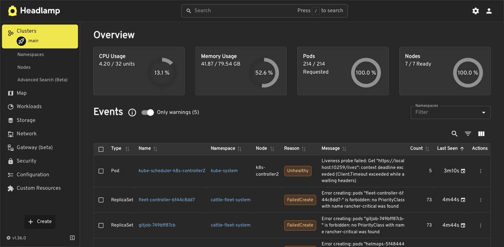

Headlamp is the cluster's only UI, for browsing resources, logs and events; changes still go through code and [Argo CD](/platform/argocd/). [Upstream docs](https://headlamp.dev/docs/latest/).

| | |
|---|---|
| Namespace | `headlamp` |
| Source | [`headlamp.go`](src:workloads/management/headlamp.go) |
| Exposure | LAN · `headlamp.madhan.app` → `headlamp:80` |
| Storage | — |
| Auth | Authentik OIDC (`grafana-admins` → `cluster-admin`); fallback token for ServiceAccount `headlamp-admin` |

## Configuration

| Setting | Value | Why |
|---|---|---|
| `ingress.enabled` | `false` | Exposed through the Gateway instead |
| ServiceAccount + ClusterRoleBinding | `headlamp-admin` → `cluster-admin` | Login identity; no static token Secret exists |
| Resources | limits `500m` / `512Mi` | Small dashboard |

## Authentik login

**Sign In** sends you to Authentik's `kubernetes` app. Headlamp then calls the API with your ID token, which the API server trusts through `oidc-*` flags in the control-plane patch ([`talos.go`](src:core/platform/talos.go)). You act as `oidc:<github username>` in groups `oidc:<authentik group>`; the `oidc-grafana-admins` ClusterRoleBinding makes `grafana-admins` cluster-admin.

The client secret comes from OpenBao `secret/headlamp` (`OIDC_CLIENT_SECRET`, seeded from SOPS `KUBERNETES_OAUTH_CLIENT_SECRET`).

## Operate

If Authentik is down, mint a token (default lifetime `24h`) and paste it into the login screen:

```bash frame="terminal"
just headlamp-token        # or: just headlamp-token 8h
```

CPU and memory columns need [Metrics Server](/workloads/monitoring/metrics-server/). From outside the LAN, connect through the [NetBird VPN](/cloud/netbird/).



## Troubleshooting

### Token rejected

It expired, or `headlamp-admin` was recreated. Run `just headlamp-token` again.

### Resource columns show N/A

Metrics Server is down. Check `kubectl top nodes`.
