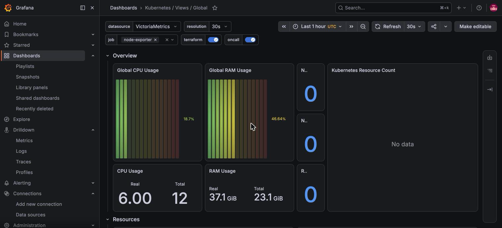

Grafana is the UI over VictoriaMetrics and VictoriaLogs. It is the one public workload, with its own OIDC login. [Upstream docs](https://grafana.com/docs/grafana/latest/).

| | |
|---|---|
| Namespace | `grafana` |
| Source | [`grafana.go`](src:workloads/monitoring/grafana.go) |
| Exposure | Public · `grafana.madhan.app` (in `publicServices`, `SkipAuth`) |
| Storage | 10Gi RWX on the default `longhorn` class |
| Auth | Authentik OIDC (GitHub login); login form disabled |

`SkipAuth` leaves out Bifrost's Authentik ForwardAuth, since Grafana's own OIDC login would make it a second prompt.



## Organizations

Non-admin SSO users never see logs.

| Org | ID | Who | Role | Datasources | Dashboards |
|---|---|---|---|---|---|
| Main Org. | `1` | Authentik group `grafana-admins` | Admin | VictoriaMetrics, VictoriaLogs | Every sidecar ConfigMap |
| Public | `2` | Every other SSO user | Viewer | VictoriaMetrics | Kubernetes Views Global (`15757`), NVIDIA DCGM (`12239`) |

`org_mapping` (`grafana-admins:1:Admin *:2:Viewer`) is re-evaluated on every login. Public-org dashboards are downloaded from grafana.com by the chart's init container, so the pod needs outbound internet to start.

## Configuration

| Setting | Value | Why |
|---|---|---|
| `server.root_url` | `https://grafana.madhan.app` | TLS ends at Bifrost, so without it Grafana builds an `http://` OAuth callback that Authentik rejects |
| `auth.generic_oauth.client_id` | `grafana-homelab` | Matches the provider in [`authentik.go`](src:core/cloud/authentik.go) |
| `auth.disable_login_form` | `true` | SSO only |
| Admin password | `$__file{/mnt/secrets/ADMIN_PASSWORD}` | Read from the CSI mount; the distroless image does not support `GF_*__FILE` |
| OAuth secret | `envFromSecret: grafana-oauth-secret` | CSI-synced from OpenBao key `OAUTH_CLIENT_SECRET` |
| VictoriaLogs URL | `…:9428/select` | The Loki plugin appends `/loki/api/v1/…` itself |
| `logsVolumeEnabled` | `false` | VictoriaLogs has no Loki volume API |
| Dashboard sidecar | label `grafana_dashboard: "1"`, all namespaces | Any chart can ship a dashboard as a ConfigMap; folder from `grafana_folder` |
| `defaultCurlOptions` | `-sf` | The chart default adds `-k`, which skips TLS verification |

OpenBao keys at `secret/grafana`: `ADMIN_PASSWORD`, `OAUTH_CLIENT_SECRET`, seeded by `just openbao-setup`.

## Operate

On a fresh cluster, create the Public org before Argo CD syncs the two-org config: Grafana refuses to start while provisioning references a missing org.

```bash frame="terminal"
just grafana-init   # creates org "Public", asserts it got ID 2; idempotent
```

Grant admin by adding the user to `grafana-admins` in Authentik, Directory → Groups.

Break-glass when SSO is down: reset the local admin password and use the API with basic auth.

```bash frame="terminal"
kubectl exec -n grafana deploy/grafana -c grafana -- grafana-cli admin reset-admin-password '<new-password>'
curl -u admin https://grafana.madhan.app/api/org
```

## Troubleshooting

### Login fails with `redirect_uri` mismatch from outside the LAN

`root_url` is unset or wrong, so the callback is `http://`. Check `grafana.ini` in the rendered values.

### "Invalid client_secret" at login

`grafana-oauth-secret` is missing because the CSI mount failed. Check OpenBao is unsealed and the `grafana` role exists:

```bash frame="terminal"
kubectl get secret grafana-oauth-secret -n grafana
kubectl describe pod -n grafana -l app.kubernetes.io/name=grafana | grep -A5 openbao-secrets
```

### Pod stuck in `Init` after a restart

The dashboard download init container cannot reach grafana.com. Check the node's outbound DNS and internet.
