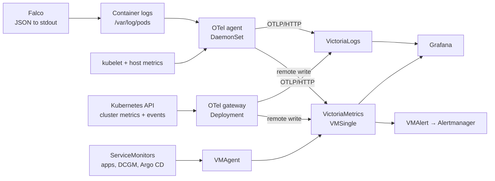

import { LinkCard, CardGrid } from '@astrojs/starlight/components';

Two collectors feed two stores, and Grafana reads both. Alertmanager ships inside the VictoriaMetrics stack, not as its own app.

<CardGrid>
  <LinkCard title="Grafana" href="/workloads/monitoring/grafana/" description="Dashboards, two orgs and Authentik SSO. Public." />
  <LinkCard title="Argo CD monitor" href="/workloads/monitoring/argocd-monitor/" description="Metrics Services, ServiceMonitors and the TLS certificate for Argo CD." />
  <LinkCard title="VictoriaMetrics" href="/workloads/monitoring/victoria-metrics/" description="VMSingle, VMAgent, VMAlert and Alertmanager from one chart." />
  <LinkCard title="VictoriaLogs" href="/workloads/monitoring/victoria-logs/" description="Log store fed over OTLP, queried through Grafana's Loki plugin." />
  <LinkCard title="OpenTelemetry" href="/workloads/monitoring/opentelemetry/" description="Agent DaemonSet and gateway Deployment collector pipelines." />
  <LinkCard title="Metrics Server" href="/workloads/monitoring/metrics-server/" description="Metrics API for kubectl top, HPAs and Headlamp." />
</CardGrid>
