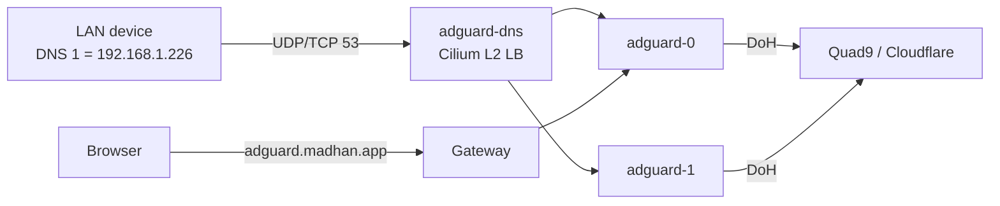

import { Steps, Tabs, TabItem } from '@astrojs/starlight/components';

AdGuard Home answers DNS for the devices pointed at it and drops ad and tracker domains. [Upstream docs](https://github.com/AdguardTeam/AdGuardHome/wiki).

| | |
|---|---|
| Namespace | `adguard` |
| Source | [`adguard.go`](src:workloads/networking/adguard.go), [`adguard_config.yml`](src:workloads/networking/adguard_config.yml) |
| Exposure | LAN · DNS LoadBalancer `192.168.1.226:53` (UDP + TCP) · UI `adguard.madhan.app` |
| Storage | None (`emptyDir`); query logs and stats reset on restart |
| Auth | UI user `admin`, password in OpenBao; no SSO (AdGuard has no OIDC) |

## How it fits



A StatefulSet runs two pods with required anti-affinity, so they land on different nodes and a node reboot does not take DNS down. Both serve DNS; the UI route goes to `adguard-0` only, because login sessions and query logs are per pod. A Homepage tile under **Apps** links the UI.

## Configuration

| Setting | Value | Why |
|---|---|---|
| DNS LoadBalancer | `adguard-dns`, `192.168.1.226` (`cluster.lb_ips.adguard` in [`config.yml`](src:config/config.yml)) | Clients are configured by IP, so it never moves |
| `externalTrafficPolicy` | `Cluster` (default) | Any node can take the L2 lease; the cost is that clients appear as node IPs in the query log |
| `ratelimit` | `0` | Every client shares a node IP, so a per-client limit would throttle the whole house |
| Upstreams | Quad9 and Cloudflare DNS-over-HTTPS, `load_balance` | Encrypted upstream; either provider can fail |
| Blocklists | AdGuard DNS filter, AdAway Default Blocklist | |
| Security context | UID/GID `65534`, non-root | The image grants `cap_net_bind_service`, so port 53 works unprivileged |
| Metrics | `adguard-exporter` sidecar on `:9618`, ServiceMonitor `adguard` | Dashboard **AdGuard Home Exporter** ships as a ConfigMap for the [Grafana](/workloads/monitoring/grafana/) sidecar |

The config is owned by git. An init container renders [`adguard_config.yml`](src:workloads/networking/adguard_config.yml) into each pod at start, substituting the admin password hash from OpenBao. **Changes made in the UI last only until the pod restarts.**

OpenBao keys at `secret/adguard`: `ADMIN_PASSWORD` (read by the exporter) and `ADMIN_PASSWORD_HASH` (bcrypt, read by the init container). Both are mounted as files; no Secret is synced.

## Operate

First deploy: `just openbao-setup` must run (by you) **before** the pods can start. It creates the `adguard` role and seeds both keys; until then the CSI mount fails and the pods stay in `ContainerCreating`.

Log in to `https://adguard.madhan.app` as `admin`:

```bash frame="terminal"
just openbao-get secret/adguard ADMIN_PASSWORD
```

Change upstreams or blocklists: edit `adguard_config.yml` and push. Reloader restarts the pods when the ConfigMap changes.

## Client setup

The AT&T BGW320 gateway cannot change the DNS servers its DHCP hands out, so set DNS by hand on each device that should be filtered: **DNS 1** `192.168.1.226`, **DNS 2** `9.9.9.9` (Quad9).

<Tabs>
  <TabItem label="macOS">
    <Steps>
    1. System Settings → Network → the active Wi-Fi or Ethernet → **Details** → **DNS**.
    2. Replace the list with `192.168.1.226` and `9.9.9.9`, in that order.
    3. Check: `dig +short doubleclick.net @192.168.1.226` returns `0.0.0.0`.
    </Steps>
  </TabItem>
  <TabItem label="Windows">
    <Steps>
    1. Settings → Network & internet → the active adapter → **Hardware properties** → DNS server assignment → **Edit**.
    2. Set **Manual**, IPv4 on, preferred `192.168.1.226`, alternate `9.9.9.9`.
    3. Check: `Resolve-DnsName doubleclick.net -Server 192.168.1.226` returns `0.0.0.0`.
    </Steps>
  </TabItem>
  <TabItem label="TV">
    <Steps>
    1. Network settings → the active connection → IP settings → **Manual** (or **Static**).
    2. Keep the IP, subnet and gateway the TV already has; set DNS 1 `192.168.1.226`, DNS 2 `9.9.9.9`.
    3. Reconnect, then check the device's queries appear in the AdGuard query log.
    </Steps>
  </TabItem>
</Tabs>

If the cluster is down, devices fall back to Quad9 and keep resolving, unfiltered. Blocking is partial even when it is up: some operating systems query both servers and use whichever answers first.

A router behind the BGW320 in IP Passthrough mode would hand out `192.168.1.226` by DHCP and cover every device without per-device setup.

## Troubleshooting

### Pods Pending

Required anti-affinity needs two schedulable workers. Check for a cordoned or `NotReady` node with `kubectl get nodes`.

### Pods stuck in ContainerCreating with a CSI mount error

The `adguard` OpenBao role or keys do not exist yet. Run `just openbao-setup`, then delete the pods.

### `192.168.1.226` unreachable after a Cilium restart

Stale L2 announcement lease: the holder renews it but stops answering ARP. `just gateway-repair-l2` repairs only the Gateway's lease; for DNS, delete this one and Cilium re-elects a holder within seconds:

```bash frame="terminal"
kubectl delete lease -n kube-system cilium-l2announce-adguard-adguard-dns
```

See [Repairs](/operate/repairs/).
