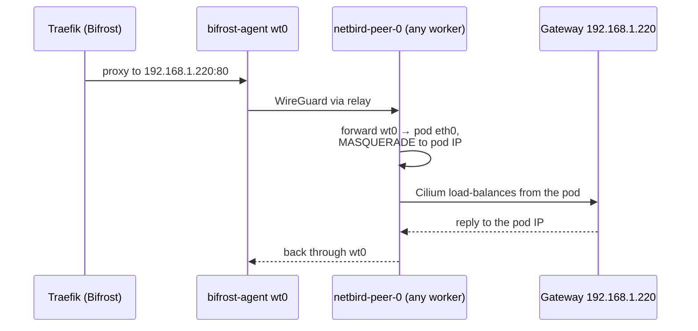

`k8s-routing-peer` joins the NetBird mesh and routes the cluster LAN to Bifrost, so Traefik there can proxy public services to the Gateway. Mesh and Bifrost side: [NetBird](/cloud/netbird/). [Upstream docs](https://docs.netbird.io/).

| | |
|---|---|
| Namespace | `netbird` (privileged PSA) |
| Source | [`netbird_peer.go`](src:workloads/networking/netbird_peer.go) |
| Exposure | None; it is the path for public traffic |
| Storage | `netbird-config` PVC, 100 Mi RWO, at `/var/lib/netbird/` |
| Auth | `NETBIRD_SETUP_KEY` from OpenBao `secret/netbird`, first registration only |

## How it fits



The StatefulSet has **no nodeSelector**; the pod runs on whichever worker schedules it. Because `wt0` lives in the pod's own network namespace, forwarded traffic leaves through the pod's `eth0` and Cilium load-balances it like any pod traffic, wherever the Gateway's L2 lease is. With `hostNetwork` the peer depended on ARP for `192.168.1.220`, which fails when the peer shares a node with the lease holder: a node cannot resolve the IP it announces itself. The MASQUERADE rule means backends see the pod IP, so no node needs a route to the NetBird overlay. No such route exists in [`talos.go`](src:core/platform/talos.go); nodes get only a default route via the router.

## Configuration

| Setting | Value | Why |
|---|---|---|
| Kind | StatefulSet, 1 replica | Stable identity with its PVC |
| PVC mount | `/var/lib/netbird/` | NetBird keeps its private key there; without it every restart registers a duplicate peer |
| `hostNetwork` | `false` (default) | `wt0` and its routes stay in the pod netns; see above |
| Capabilities | `NET_ADMIN`, `SYS_MODULE`, privileged | WireGuard and iptables |
| Image | `netbird` in [`config.yml`](src:config/config.yml) | Must match the Bifrost server; see [Software inventory](/reference/software-inventory/) |
| `NB_MANAGEMENT_URL` | `https://netbird.madhan.app` | Management server on Bifrost |
| `NB_HOSTNAME` | `k8s-routing-peer` | Name the NetBird route is assigned to |
| Reloader | `reloader.stakater.com/auto` | Restarts when the setup-key Secret changes |

The cluster subnet route is **not** set in code. Assign it in the NetBird UI: **Network → Routes**, network `192.168.1.0/24`, routing peer `k8s-routing-peer`, distribution group `All`.

### MASQUERADE initContainer

`setup-iptables` runs before the agent:

```bash
iptables -t nat -C POSTROUTING ! -o wt0 -d 192.168.1.0/24 -j MASQUERADE 2>/dev/null \
  || iptables -t nat -A POSTROUTING ! -o wt0 -d 192.168.1.0/24 -j MASQUERADE
```

It matches "not back out `wt0`" rather than a NIC name. `-C` stops restarts from stacking duplicates. While the route's **Masquerade** toggle is on in the NetBird UI, NetBird's own `NETBIRD-RT-NAT` chain matches first and this rule counts 0 packets; it is the fallback if that toggle is ever turned off.

:::danger[Never set NB_SKIP_SOCKET_MARK]
The peer adds a host route for the management server via `lo`; socket fwmark lets its own traffic bypass it. Without the mark, management traffic loops into the tunnel, the relay never connects, and `wt0` carries 0 bytes: every public service goes down. Details: [NetBird](/cloud/netbird/).
:::

:::caution[Keep wt0 out of Cilium devices]
`wt0` is NOARP/POINTOPOINT; Cilium's TC BPF drops its frames silently. [`cilium.go`](src:core/platform/cilium.go) lists only `ens18` and `eth0`. See [Cilium](/platform/cilium/).
:::

## Operate

```bash frame="terminal"
kubectl get pods -n netbird -o wide           # which worker it landed on
kubectl exec -n netbird netbird-peer-0 -c netbird -- netbird status
```

Expect `Management: Connected` and `Networks: 192.168.1.0/24`.

## Troubleshooting

### Peer not connecting

Check logs, then that the management URL answers from the pod:

```bash frame="terminal"
kubectl logs -n netbird netbird-peer-0 -c netbird --tail=30
kubectl exec -n netbird netbird-peer-0 -c netbird -- \
  wget -qO- --timeout=5 https://netbird.madhan.app/api/v1/peers
```

### bifrost-agent shows `Networks: -`

The route is missing in the NetBird UI or points at a stale peer. Delete old entries and assign it to the current `k8s-routing-peer`. Confirm on Bifrost:

```bash frame="terminal"
ssh root@178.156.199.250 'docker exec netbird-agent netbird routes list'   # 192.168.1.0/24 Selected
```

### 504 from public services, tunnel up

Work from the peer's node outward:

```bash frame="terminal"
NODE=$(kubectl get pod -n netbird netbird-peer-0 -o jsonpath='{.spec.nodeName}')
CILIUM=$(kubectl get pods -n kube-system -l app.kubernetes.io/name=cilium-agent \
  --field-selector spec.nodeName=$NODE -o name)
kubectl exec -n kube-system $CILIUM -c cilium-agent -- cilium-dbg status | grep Devices   # no wt0
ssh root@178.156.199.250 'ip route show table 7120'                                      # 192.168.1.0/24 dev wt0
ssh root@178.156.199.250 \
  'curl -s -o /dev/null -w "%{http_code}\n" -H "Host: grafana.madhan.app" --connect-timeout 5 http://192.168.1.220/'
```

A `302` from the last command means the path works and the problem is in Traefik.

### MASQUERADE rule not matching

```bash frame="terminal"
kubectl exec -n netbird netbird-peer-0 -c netbird -- iptables -t nat -L POSTROUTING -n -v | grep MASQUERADE
```

The `! -o wt0` rule to `192.168.1.0/24` should show a growing packet count. If it is missing, check that `setup-iptables` completed in `kubectl describe pod`.

### `wt0` shows 0 bytes

`NB_SKIP_SOCKET_MARK` is set somewhere; remove it (see the danger aside).
