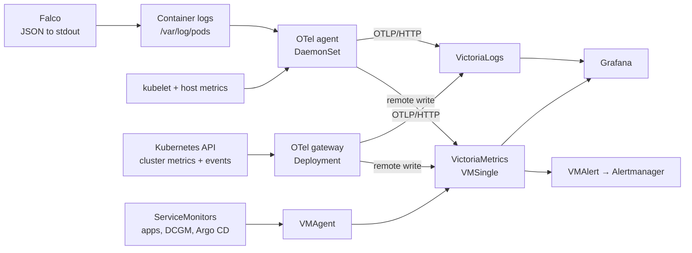

import { LinkCard, CardGrid } from '@astrojs/starlight/components';

Two collectors feed two stores, and [Grafana](/workloads/monitoring/grafana/) reads both. Alertmanager ships inside the VictoriaMetrics stack, not as its own app.

<CardGrid>
  <LinkCard title="VictoriaMetrics" href="/workloads/observability/victoria-metrics/" description="VMSingle, VMAgent, VMAlert and Alertmanager from one chart." />
  <LinkCard title="VictoriaLogs" href="/workloads/observability/victoria-logs/" description="Log store fed over OTLP, queried through Grafana's Loki plugin." />
  <LinkCard title="OpenTelemetry" href="/workloads/observability/opentelemetry/" description="Agent DaemonSet and gateway Deployment collector pipelines." />
  <LinkCard title="Argo CD monitor" href="/workloads/observability/argocd-monitor/" description="Metrics Services, ServiceMonitors and the TLS certificate for Argo CD." />
</CardGrid>
