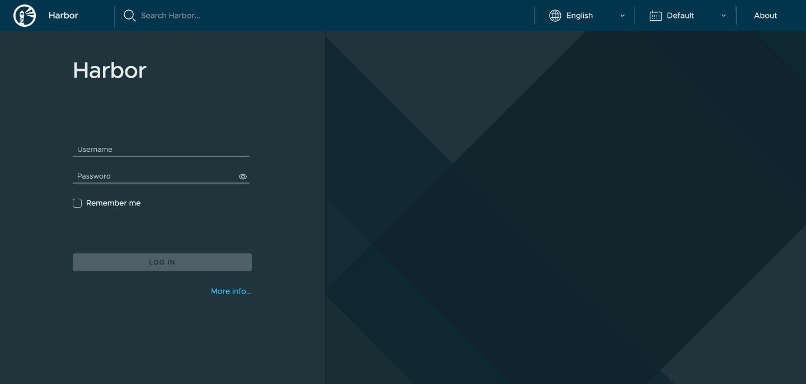
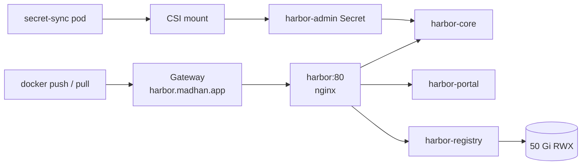

import { Steps } from '@astrojs/starlight/components';

Harbor stores the homelab's own images and caches upstream registries so repeat pulls stay on the LAN. [Upstream docs](https://goharbor.io/docs/).

| | |
|---|---|
| Namespace | `harbor` |
| Source | [`harbor.go`](src:workloads/registry/harbor.go) |
| Exposure | LAN · `harbor.madhan.app` → `harbor:80` |
| Storage | Registry 50 Gi RWX, jobservice RWX, database 10 Gi RWO (Longhorn) |
| Auth | Authentik OIDC (`grafana-admins` = Harbor admins); local `admin` at `/account/sign-in`, password from OpenBao `secret/harbor` |

Harbor won over a plain Docker registry for RBAC, scanning and the proxy cache; see [Harbor for the registry](/reference/decisions/harbor/).



## How it fits



## Configuration

| Setting | Value | Why |
|---|---|---|
| HTTPRoute backend | `harbor:80` | The nginx proxy routes to core, portal and registry |
| `expose.type` / `expose.tls.enabled` | `clusterIP` / `false` | The Gateway terminates TLS |
| `externalURL` | `https://harbor.madhan.app` | Used in redirects and push instructions |
| Registry and jobservice PVC `accessMode` | `ReadWriteMany` | Old and new pods can both mount during a rollout |
| `existingSecretAdminPassword` | `harbor-admin` | Mirrored from OpenBao; `harborAdminPassword` is empty |
| `secret-sync` Deployment | `pause` pod mounting the CSI volume | The chart cannot add volumes to its own pods, and the mount is what creates the Secret ([Secrets](/concepts/secrets/)) |

:::caution[The HTTPRoute must target `harbor`, not `harbor-core`]
`harbor-core` serves only the API. Routing straight to it leaves the UI blank and breaks `docker push` with 404s.
:::

## Operate

### Authentik login

`CONFIG_OVERWRITE_JSON` on harbor-core sets `auth_mode: oidc_auth` and the OIDC settings on every start, so changes made in **Configuration → Authentication** reset on restart; edit [`harbor.go`](src:workloads/registry/harbor.go) instead. Users are created on first login from `preferred_username`. The client secret comes from OpenBao `secret/harbor` (`OIDC_CLIENT_SECRET`), mirrored into `harbor-admin`.

For `docker login`, use the **CLI secret** from **User Profile**, not the Authentik password.

If the client secret changes, restart harbor-core after the CSI driver re-syncs `harbor-admin` (up to 2 minutes): the chart offers no Deployment annotation for Reloader.

### Rotate the admin password

`HARBOR_ADMIN_PASSWORD` only seeds the admin account on the first database init; changing it in OpenBao does nothing to a running install.

<Steps>
1. Change it in Harbor: **admin (top right) → Change Password**, or
   ```bash frame="terminal"
   url=https://harbor.madhan.app/api/v2.0/users/1/password   # API path, not a version claim. docs-check: historical
   curl -u admin -X PUT "$url" -H 'Content-Type: application/json' \
     -d '{"old_password":"OLD","new_password":"NEW"}'
   ```
2. Write the same value to OpenBao `secret/harbor` so a rebuilt database seeds it (see [OpenBao](/workloads/secrets/openbao/#change-a-value)).
</Steps>

### Add a pull-through cache

<Steps>
1. Log in to `https://harbor.madhan.app` as admin.
2. **Administration → Registries → New Endpoint**: add Docker Hub, GHCR or another upstream.
3. **Projects → New Project**, enable **Proxy Cache**, and pick that endpoint.
4. Pull through it: `harbor.madhan.app/<project>/<image>:<tag>`.
</Steps>

{/* TODO screenshot: Harbor projects page with a proxy-cache project and scan results */}

## Troubleshooting

### Multi-Attach error on a rollout

Registry and jobservice volumes are RWX and the database runs as a StatefulSet, so Harbor should no longer hit this. Any Deployment with an RWO volume can: the new pod lands on another node while the old one still holds the volume.

<Steps>
1. Find the old ReplicaSet:
   ```bash frame="terminal"
   kubectl get replicasets -n harbor
   ```
2. Scale it to zero:
   ```bash frame="terminal"
   kubectl scale replicaset <old-rs> -n harbor --replicas=0
   ```
3. Force-delete the stuck pod:
   ```bash frame="terminal"
   kubectl delete pod -n harbor <stuck-pod> --grace-period=0 --force
   ```
</Steps>

### UI blank or push returns 404

The route points at the wrong Service. Expect `name: harbor`, `port: 80`:

```bash frame="terminal"
kubectl get httproute harbor -n harbor -o jsonpath='{.spec.rules[*].backendRefs}'
```

### Admin login fails

Check that the `secret-sync` pod is running and the Secret exists, then compare with OpenBao:

```bash frame="terminal"
kubectl get pods -n harbor -l app=secret-sync
kubectl get secret harbor-admin -n harbor
just openbao-get secret/harbor HARBOR_ADMIN_PASSWORD
```

If the database was initialised earlier with another value, the OpenBao value is ignored; rotate in Harbor as above.
