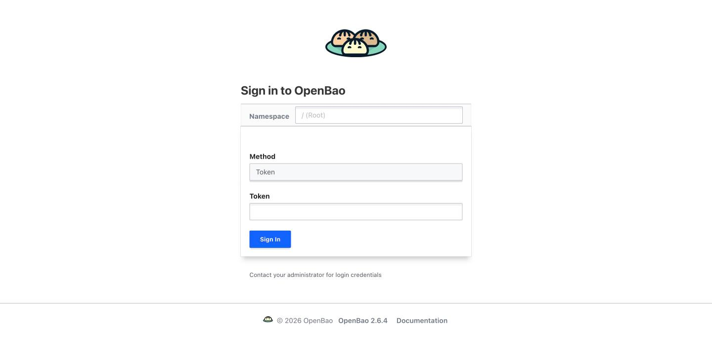

OpenBao holds every runtime secret; pods read them through the [CSI driver](/workloads/secrets/csi-driver/) using Kubernetes auth. The model is in [Secrets](/concepts/secrets/). [Upstream docs](https://openbao.org/docs/).

| | |
|---|---|
| Namespace | `openbao` (privileged PSA, for the CSI provider DaemonSet) |
| Source | [`openbao.go`](src:workloads/secrets/openbao.go), [`openbao-setup.sh`](src:scripts/openbao-setup.sh) |
| Exposure | LAN · `openbao.madhan.app` → `openbao:8200` |
| Storage | 10 Gi Longhorn, `file` backend |
| Auth | Root tokens minted per command by `just openbao-root` |



## Configuration

| Setting | Value | Why |
|---|---|---|
| Mode | `standalone`, `file` storage | Single node, no Consul |
| Server image | Pinned separately from the chart's appVersion | Newer releases drop the `file` backend |
| `injector.enabled` / `csi.enabled` | `false` / `true` | Secrets reach pods only through CSI |
| `unix` listener | `/tmp/openbao.sock`, unauthenticated generate-root allowed | The only path for `just openbao-token`; off on every other listener |
| `audit "file" "stdout"` | In config | API audit creation is disabled, so it must be declarative |
| Telemetry | `unauthenticated_metrics_access`, ServiceMonitor on `/v1/sys/metrics` | VMAgent scrapes without a token |
| `unseal` sidecar | `extraContainers`, loops every 15 s | See below |

### Unseal sidecar

OpenBao starts sealed after every restart. The `unseal` container polls `bao status` and unseals with `OPENBAO_UNSEAL_KEY` from the `openbao-unseal-key` Secret. It is a sidecar because an init container would run before the server could accept the request. Only the sidecar sees the key.

`openbao-unseal-key` is a bootstrap Secret from `just create-secrets`, annotated `Prune=false` so Argo CD never deletes it.

### Roles and paths

`just openbao-setup` writes one read-only policy and Kubernetes auth role per app, bound to that app's namespace, and seeds missing keys (it never overwrites).

| Role / path `secret/<app>` | ServiceAccount | Keys |
|---|---|---|
| `grafana` | `grafana` | `ADMIN_PASSWORD`, `OAUTH_CLIENT_SECRET` |
| `harbor` | `secret-sync` | `HARBOR_ADMIN_PASSWORD` |
| `n8n` | `n8n` | `ENCRYPTION_KEY` |
| `netbird` | `default` | `NETBIRD_SETUP_KEY` |
| `falco` | `secret-sync` | `FALCOSIDEKICK_UI_USER` |
| `cs2` | `cs2` | `RCON_PASSWORD`, `JOIN_PASSWORD` |

## Operate

First-time init and setup are part of the [deployment guide](/start/deploy/). The server StatefulSet uses `OnDelete`, so a config change takes effect only after `kubectl delete pod -n openbao openbao-0`.

No root token is stored. `just openbao-root <bao args>` runs the generate-root ceremony over the in-pod socket, runs one `bao` command with the token, and revokes it on exit. The token and any piped value travel on stdin, never in a process list.

### Read a secret

```bash frame="terminal"
just openbao-get secret/grafana
just openbao-get secret/grafana ADMIN_PASSWORD
```

### Change a value

```bash frame="terminal"
printf '%s' '<new value>' | just openbao-root kv patch -mount=secret grafana ADMIN_PASSWORD=-
```

### Any other bao command

```bash frame="terminal"
just openbao-root read auth/kubernetes/role/grafana
```

To test what an app itself can read, use `just openbao-sa-get <sa> <ns> <role> secret/<app>`.

{/* TODO screenshot: OpenBao UI showing the secret/ KV mount and Kubernetes auth roles */}

## Troubleshooting

### Sealed after a restart

Pods that need secrets hang in `ContainerCreating`. Check the sidecar:

```bash frame="terminal"
kubectl exec -n openbao openbao-0 -c openbao -- bao status
kubectl logs -n openbao openbao-0 -c unseal
```

Unseal by hand if the sidecar is broken:

```bash frame="terminal"
kubectl get secret openbao-unseal-key -n openbao -o jsonpath='{.data.unseal-key}' | base64 -d |
  kubectl exec -i -n openbao openbao-0 -c openbao -- sh -c 'read -r k; bao operator unseal "$k"'
```

### 403 / permission denied on a CSI mount

The pod's ServiceAccount or namespace does not match its role. Run `just openbao-setup` to rewrite roles, and check the provider logs:

```bash frame="terminal"
kubectl logs -n openbao -l app.kubernetes.io/name=openbao-csi-provider
```

A new app needs an entry in the `roles` list in [`openbao-setup.sh`](src:scripts/openbao-setup.sh).
