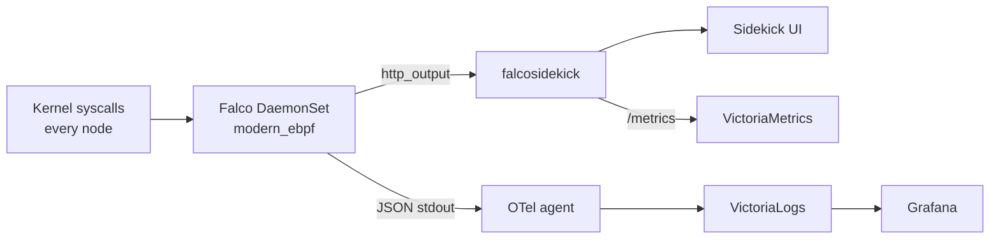

Falco watches syscalls on every node and alerts on suspicious behaviour such as a shell in a container. Falcosidekick fans alerts out and serves a UI. [Upstream docs](https://falco.org/docs/).

| | |
|---|---|
| Namespace | `falco` (privileged PSA) |
| Source | [`falco.go`](src:workloads/security/falco.go) |
| Exposure | LAN · `falco.madhan.app` → `falco-falcosidekick-ui:2802` |
| Storage | Sidekick UI Redis, 1 Gi (chart default) |
| Auth | Sidekick UI login `FALCOSIDEKICK_UI_USER` from OpenBao `secret/falco` |

## How it fits



## Configuration

| Setting | Value | Why |
|---|---|---|
| `driver.kind` | `modern_ebpf` | Talos blocks kernel modules; the CO-RE probe needs none |
| `driver.sysfsMountPath` | `/sys/kernel` | Exposes BTF at `/sys/kernel/btf/vmlinux` |
| `json_output`, `json_include_output_property` | `true` | Structured alerts for VictoriaLogs |
| `tolerations` | `operator: Exists` | Control planes are monitored too |
| Resources | limits `1000m` / `1024Mi` | Rule evaluation on busy nodes is CPU-heavy |
| `webui.replicaCount` | `1` | The key is `replicaCount`; `replicas` is ignored and leaves 2 |
| `webui.ttl` | `7d` | Without it Redis fills its volume (see below) |
| `webui.user` / `existingSecret` | empty / `falcosidekick-ui-auth` | Keeps the chart's `admin:admin` out of the rendered Secret, which lands on a public branch |

The UI chart cannot add volumes, so a `secret-sync` pod mounts the CSI volume that creates `falcosidekick-ui-auth`.

## Operate

Read the UI login with `just openbao-get secret/falco FALCOSIDEKICK_UI_USER` (format `user:password`). Query alerts in Grafana's VictoriaLogs datasource, filtered on namespace `falco`.

## Troubleshooting

### Probe fails to load (`BTF not found`)

`sysfsMountPath` is missing; the container's default sysfs on Talos hides `/sys/kernel/btf`.

```bash frame="terminal"
kubectl logs -n falco -l app.kubernetes.io/name=falco --tail=50 | grep -iE 'btf|ebpf|probe'
```

### Sidekick UI stuck in `wait-redis`

Redis answered `MISCONF`: once the dataset passes half the 1 Gi volume, a save (which writes a full temp copy) fails with `No space left on device`. `webui.ttl` keeps the dataset below that.

### Render fails after a chart bump

Config keys are snake_case (`json_output`, `http_output`); camelCase keys are silently ignored. Newer charts also reject `falco.grpc`, `falco.grpc_output` and `driver.kind=ebpf`.
