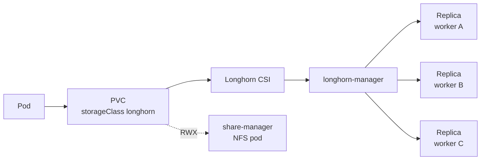
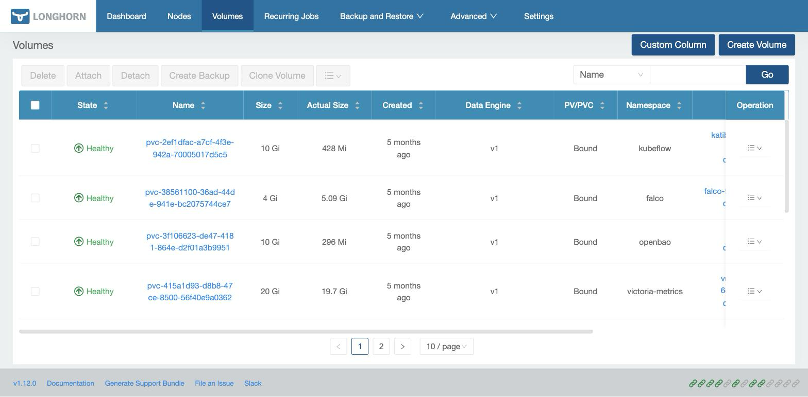

Longhorn replicates every volume across three workers, so a PVC survives losing its node. [Upstream docs](https://longhorn.io/docs/).

| | |
|---|---|
| Namespace | `longhorn-system` (privileged PSA) |
| Source | [`longhorn.go`](src:workloads/storage/longhorn.go) |
| Exposure | LAN · `longhorn.madhan.app` → `longhorn-frontend:80` |
| Storage | `/var/lib/longhorn/` on each worker's OS disk |
| Auth | None |

Longhorn was chosen because it needs no dedicated disks; see [Longhorn for storage](/reference/decisions/longhorn/).

## How it fits



RWX volumes get a Longhorn share-manager pod that serves NFS, so several pods (or an old and new pod during a rollout) can mount the same volume.

## Configuration

| Setting | Value | Why |
|---|---|---|
| `defaultReplicaCount`, `defaultClassReplicaCount` | `3` | Three of the four workers hold each volume |
| `storageOverProvisioningPercentage` | `300` | 200% ran out of schedulable space for 50 Gi AI model replicas |
| `defaultDataPath` | `/var/lib/longhorn/` | Persistent path on Talos |
| `createDefaultDiskLabeledNodes` | `false` | Every node gets a default disk, no labels needed |
| `concurrentAutomaticEngineUpgradePerNodeLimit` | `1` | Volumes move to the new engine image after an upgrade, one per node at a time |
| `preUpgradeChecker.jobEnabled` | `false` | The pre-upgrade hook does not fit Argo CD sync |
| `networkPolicies.metricsScrapeSources` | `vmagent` in `victoria-metrics` | The chart's NetworkPolicies otherwise block cross-namespace scrapes of `longhorn-manager:9500` |
| Driver and UI tolerations | control-plane `NoSchedule` | Driver and UI may run on control planes; the manager may not |

:::danger[Never let longhorn-manager tolerate the control-plane taint]
Each manager pod registers its node as a Longhorn node, and each Longhorn node needs an engine image. The engine-image DaemonSet tolerates only the `taintToleration` setting (`dedicated=ai`), so control-plane nodes would leave EngineImages stuck "deploying" and **every volume attach in the cluster blocks**. `longhornManager` tolerates `dedicated=ai` and nothing else.
:::

### Capacity

Disk sizes come from [`config.yml`](src:config/config.yml). Longhorn shares each disk with the OS and container images.

| Node | Disk |
|---|---|
| k8s-worker1–3 | 200 GiB |
| k8s-worker4 (GPU) | 250 GiB |

## Operate

```bash frame="terminal"
kubectl get volumes.longhorn.io -n longhorn-system \
  -o custom-columns=NAME:.metadata.name,STATE:.status.state,ROBUSTNESS:.status.robustness
```

Healthy volumes show `attached` / `healthy`. After a Talos upgrade, run `just longhorn-repair-iscsi` (the `talos-upgrade` flow already calls it).



## Troubleshooting

### Volumes stuck attaching after a node upgrade

An open-iscsi upgrade can reject a parameter in an old record under `/var/lib/iscsi/nodes/`, which fails every attach on that node. Run `just longhorn-repair-iscsi`.

### Volume stuck attaching, PVC Pending, or pod in ContainerCreating

Check the volume and, for RWX, its share-manager pod:

```bash frame="terminal"
kubectl describe pvc <pvc> -n <namespace>
kubectl get pods -n longhorn-system | grep share-manager
```

If one volume is wedged, detach it in the Longhorn UI, then force-delete the pod. If **every** attach is stuck, check EngineImages first (see the danger aside above): `kubectl get engineimages -n longhorn-system`.

### `ROBUSTNESS=degraded`

A replica's node is down or out of space. Longhorn rebuilds on another worker once it can schedule; check node status first.

### `Multi-Attach error for volume`

An RWO volume is still attached to the old pod's node during a rollout. Scale down the old ReplicaSet and force-delete the stuck pod; [Harbor](/workloads/registry/harbor/#multi-attach-error-on-a-rollout) has the steps. The lasting fix is `ReadWriteMany`.
