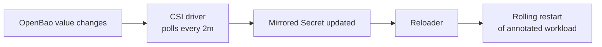

Reloader watches ConfigMaps and Secrets and rolls any annotated workload that uses them, which is how rotated OpenBao values reach running pods. [Upstream docs](https://github.com/stakater/Reloader).

| | |
|---|---|
| Namespace | `reloader` |
| Source | [`reloader.go`](src:workloads/support/reloader.go) |
| Exposure | None |
| Storage | — |
| Auth | — |

Reloader runs with chart defaults; opt in per workload on the **pod template**:

```go
"podAnnotations": map[string]any{
    "reloader.stakater.com/auto": "true",
},
```

Annotated today: Grafana, OpenBao, NetBird peer, Falco and its Sidekick UI, every `secret-sync` pod (Harbor, Falco), the OpenTelemetry collectors, the notebook gateway controller, and CS2.

## How it fits



## Troubleshooting

### Workload not restarting

The annotation is on the Deployment's metadata instead of `spec.template.metadata`, or the app reads its value as a file with no mirrored Secret behind it.

```bash frame="terminal"
kubectl get deploy <name> -n <namespace> -o jsonpath='{.spec.template.metadata.annotations}'
kubectl logs -n reloader deploy/reloader-reloader --tail=50
```
